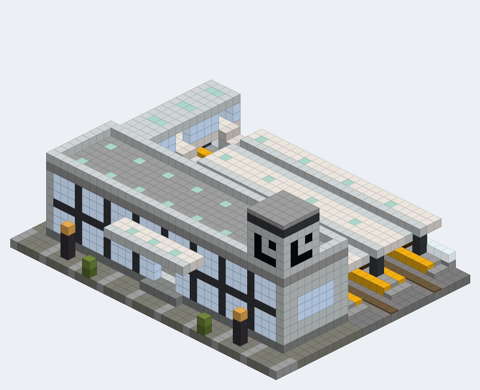
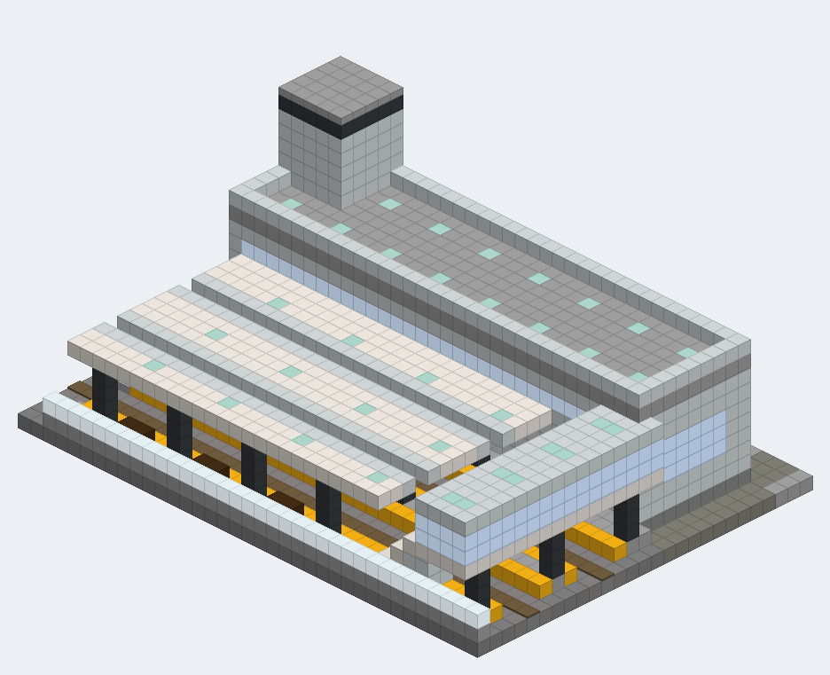

# New5 – MineColonies / Structurize content

## Modern Rail style pack

`stylepacks/ModernRail/` is a Structurize style pack (works with MineColonies).

| Blueprint | Size (x × y × z) | Notes |
|---|---|---|
| `transport/modern_train_station` | 37 × 17 × 27 | Glass-front station hall with clock tower, 2 tracks, 4 platform faces with canopies, covered footbridge. Vanilla blocks only. |




### Install
1. Copy the whole `ModernRail` folder into `.minecraft/blueprints/`
   (so you get `.minecraft/blueprints/ModernRail/pack.json`).
2. Restart the game, open the **Build Tool**, switch pack to **Modern Rail**,
   and pick `transport → modern_train_station`.
3. Place it in creative, or let your colony's builder build it as a decoration.

The anchor is the front-centre of the plaza at ground level; y=0 is the foundation layer.
Rails run the full length of the blueprint, so you can connect lines at both ends.

Made for Minecraft 1.20.1 (data version 3465); newer versions upgrade it automatically on load.

### Regenerating
Blueprints are generated from Python, not hand-built:

```bash
pip install nbtlib pillow
./tools/blueprints/build.sh
```

- `tools/blueprints/blueprint.py` – reads/writes `.blueprint` files (Structurize format v1)
- `tools/blueprints/train_station.py` – the station design
- `tools/blueprints/render.py` – isometric previews + floor plan
