# Neoterra – MineColonies style pack (NeoForge 1.21.1)

Semi-futuristic megastructures: white concrete towers and boxes, light-blue glass, cyan accents,
glowing light strips, halos and spires.
Every building has levels 1–5, grows upward level by level, and is packed with things the player can use.

Requires: MineColonies, Structurize, Domum Ornamentum (all on NeoForge 1.21.1).


## Three packs side by side
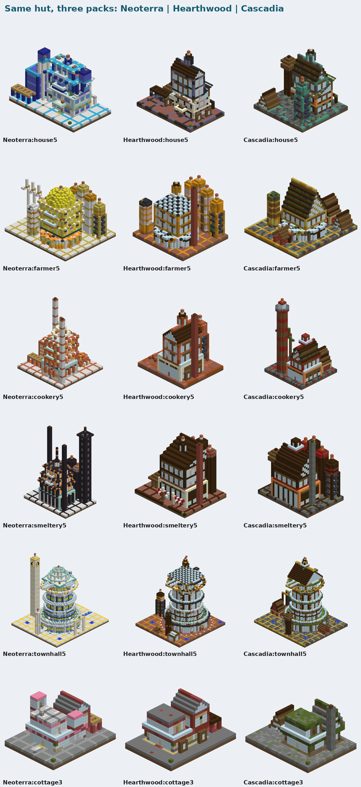

## Hearthwood – cozy modern style pack
A second style pack shipped in the same jar (`stylepacks/Hearthwood`). It starts from the same raw buildings (so
every hut's requirements are identical) but runs its own shape passes – pitched gable / hip / shed roofs from level
1, cupola and belfry crowns, and its own landmark recipe per building (porches, brick chimney stacks, glass
conservatories, gazebos, bay windows, striped awnings, ...) – then its own materials:

- warm plaster walls (white terracotta) with vertical wood-cladding panels and a stone-brick base course
- dark wood trim, spruce / dark oak stair roofs, stone-brick or tiled flat roofs, plank floors inside
- one cozy accent palette per building: terracotta, brick, sage, rose, honey, walnut, slate, plum (wool rainbow
  for the dyer)
- lanterns and glowstone, warm rugs
- levels 1-4 use only easy-to-medium blocks (planks, logs, stone, bricks, terracotta, wool, glass, copper,
  glowstone, mud bricks, honeycomb...); level 5 may use anything (deepslate, cherry, froglights, ...)

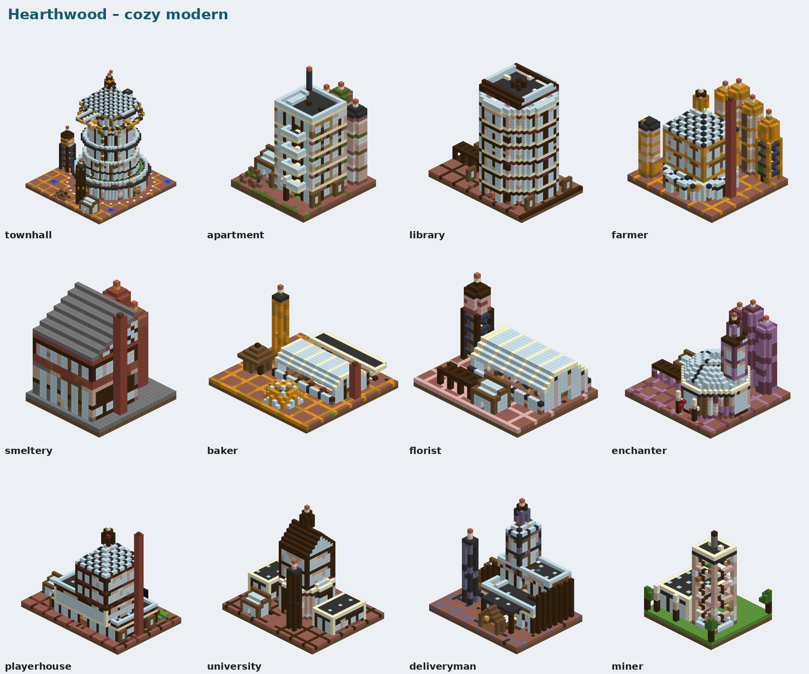

The fixed-frame huts (Skytower, barracks, miner, fisherman, plantation, tavern, gatehouse, wall tower) also get
each pack's own roof forms and crowns in Hearthwood and Cascadia (roofs only – their child buildings, shafts,
ponds and wall alignment stay untouched). Only the underground bunker is shared between packs apart from materials.

## Cascadia – Oregon / Pacific Northwest style pack
The third pack in the jar (`stylepacks/Cascadia`). Its own shapes: steep A-frame and gambrel barn roofs from level
1, lookout and cupola crowns, and per-building landmarks – red covered-bridge entrances, timber fire-lookout towers,
A-frame cabins, gambrel barns, river-stone chimneys, coast lighthouses, log stacks, water towers – with Oregon /
Pacific Northwest materials:

- cedar and fir timber: spruce siding and stripped-spruce cladding, dark oak frames, spruce shingle roofs
- river-rock base courses and aprons (cobblestone, mossy cobblestone, andesite), moss roofs
- Columbia basalt (polished / smooth basalt) at level 5
- accent palettes per building: fir green, covered-bridge red, coast teal, rain grey, timber brown, wheat ochre
- levels 1-4 use only easy-to-medium blocks; level 5 may use anything

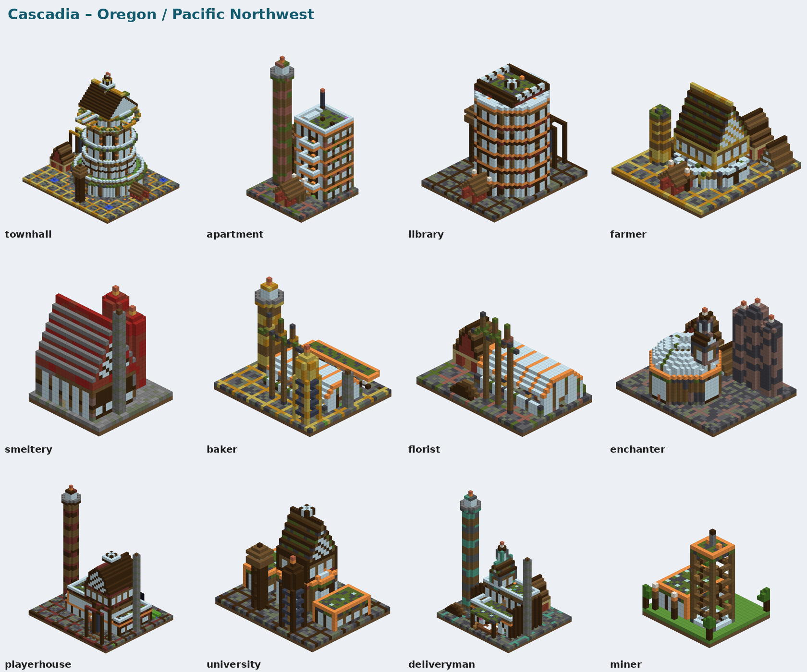

## Own architecture per pack
Hearthwood and Cascadia no longer derive any shapes from Neoterra. `tools/blueprints/neoterra/archgen.py` takes only
each hut's *requirements* from the raw generator output (hut block and tags, beds, racks, workstations,
bookshelves, seats, tagged spots, outdoor fixtures, and the exact functional layouts that game logic depends on:
fishing pond, plantation beds, mine-shaft head, nether portal, concrete basin) and designs a new building in the
pack's own architecture – plan shape, storeys, walls, windows, roofs, porches / decks, chimneys, towers, silos,
water wheels, cupolas, awnings, sunrooms – with a unique variant per building and growth level by level.
`styleinfra.py` does the same for walls, gates, watchtowers, roads, rails, canals, bridges, subway, boardwalk,
cliff climbs and parks. (Skytower, barracks, bunker, gatehouse and wall tower still use the shared frames with each
pack's own roofs and materials.)

## Twin Builders' Yard (all packs)
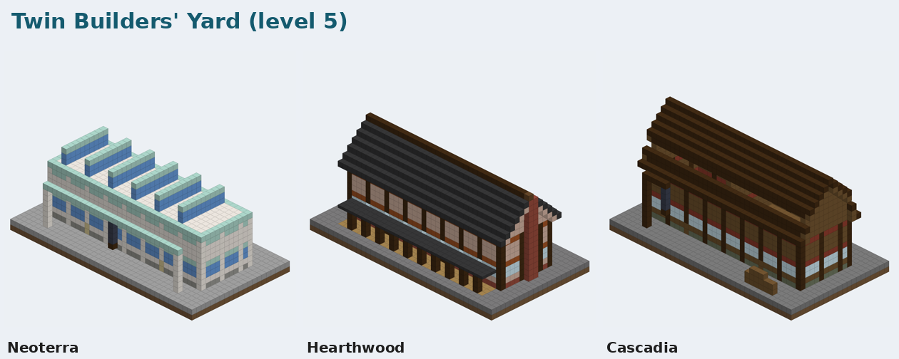

`fundamentals/twinbuilder1-5` – one building, two builders: the main builder's hut plus a child builder's hut
(`twinbuilderannex1-5`) in the second half of the hall. Each builder has its own workshop half, racks and crafting
table and upgrades independently. Designed per pack (glass workshop / plaster-and-timber carpentry house / timber
barn workshop).

## Hand-designed huts, vanilla blocks only (1.19.0)
All 52 regular hut types are now designed by hand for each pack and every level (774 buildings,
`tools/blueprints/neoterra/handmade/designs/`): each one reads as the real building – a coaching inn with a bar,
kegs and fireplace, a smithy with an open forge bay, a bakery with an oven wall and shop counter, hospital wards
with curtained beds, classrooms with desks facing a blackboard – with interiors furnished on purpose instead of
scattered blocks. Hearthwood, Cascadia and Neoterra each get their own form, size and roof per type.
- **Vanilla only:** Domum Ornamentum blocks are gone from every pack (converted to vanilla, `vanillaize.py`);
  only the architect's cutter remains where the builder's hut requires it. This also fixes walls with gaps.
- **Full plot from level 1:** every level reserves the space of its biggest level (`plotmax.py`).
- **Own field names:** Hearthwood/Cascadia fields no longer use `neo*` names (e.g. `cottagegarden`, `homesteadfield`).
- Barracks, gatehouse, wall tower, sky tower, bunker, twin builder and grand projects keep their designs (now vanilla).

## Furnished interiors (1.18.0, replaced in 1.19.0)
`furnish.py` furnishes every hut in the pack's own style – free floor spots against interior walls (about 15 % at
level 1 up to 55 % at level 5) plus rugs in the middle of bigger rooms; doors, ladders, stairs, huts, beds, racks and
work blocks keep a clear ring, and every building is walk-checked afterwards.

| Neoterra | Hearthwood | Cascadia |
|---|---|---|
| quartz sofas (Domum), counters, glass display cases, potted bamboo, cyan / grey rugs | chiseled-bookshelf bookcases, shelves with flower pots, oak benches, dressers with candles, orange / white rugs | log benches, stump stools, firewood stacks, plank tables with lanterns, river-rock hearths, brown / green rugs |

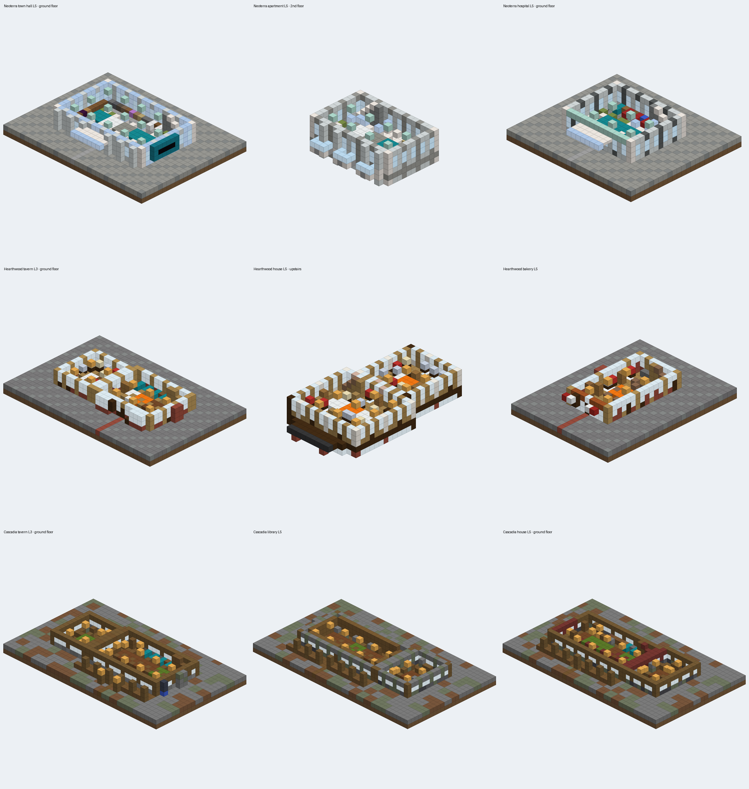

## Domum Ornamentum per pack (1.17.0, removed in 1.19.0)
`domumize.py` gives every pack its own set of Domum Ornamentum blocks – a little at levels 1-3, a lot at levels 4-5
(buildings that stop at level 3 use the level 1 / 3 / 5 rules):

| Level | Hearthwood | Cascadia | Neoterra |
|---|---|---|---|
| 2 | Domum shutters | squared timber pillars on the corner logs | framed lights, quartz Domum table tops |
| 3 | + timber-framed upper storeys (dark-oak frames, white plaster, crossed panels) | + log-cabin frames on upper storeys | + quartz square pillars on the corners, framed floor tiles, quartz Domum stairs and seats, framed quartz roof coping |
| 4 | + shingle roofs, brown tile | + cedar shingle roofs | + every light framed, standing-seam metal roofs, waffle-panel decking on flat roofs |
| 5 | + black tile shingles, frames on every storey (brick infill below) | + mossy shingles mixed in, frames on every storey | + framed light strips, iron seam roofs, checkerboard floor tiles |

Block states and texture keys follow MineColonies' own official packs. Huts, racks, beds and work blocks are never
replaced.

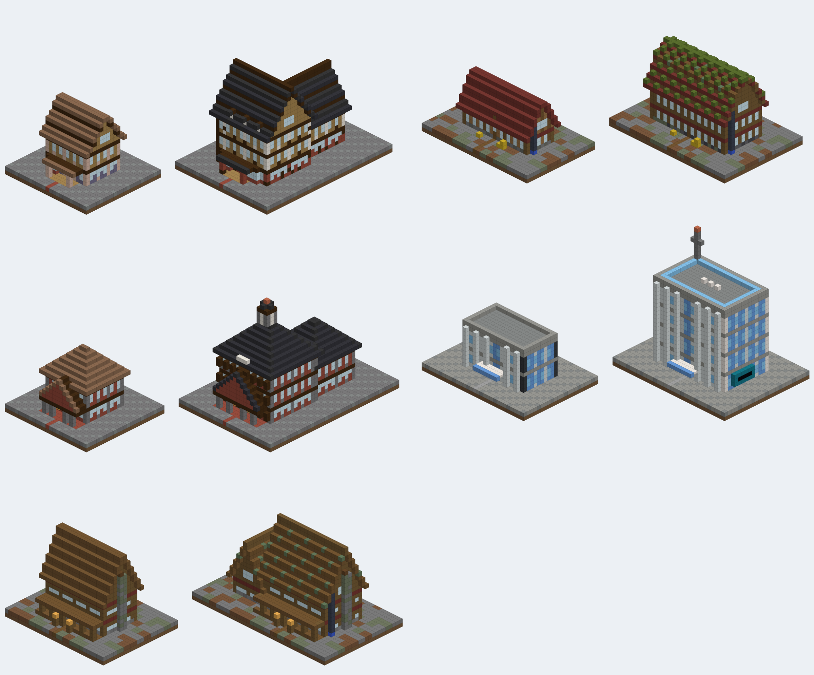
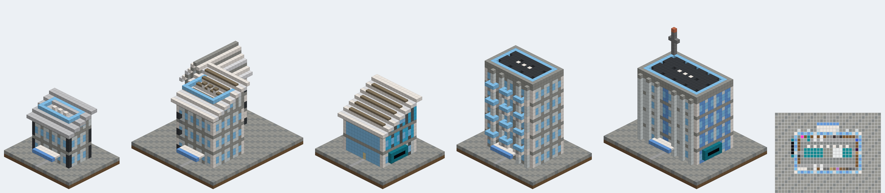

## Every pack is its own world (1.16.0)
The same hut type is a completely different building in each pack – own plan, size, roof, storey height, wall
treatment, materials and decorations (`typology.py` has a separate table per pack):

| | Neoterra | Hearthwood | Cascadia |
|---|---|---|---|
| Character | modern city: concrete, glass, steel, flat roofs, tall storeys | cosy market town: brick, plaster, half-timber, gables and hips | Pacific Northwest backcountry: logs, cedar, river rock, moss, long low lodges |
| Decorations (pack-only) | glass canopies, solar roofs, light strips, fins, roof terraces, antennas, glass cubes, screens, cooling towers | shutters, wall lanterns, bay windows, gable clocks, benches, dovecotes, hoists, chimney pots | log porches, firewood stacks, rain barrels, mossy ridges, lantern posts, rock piles, hay lofts, mine portals |
| Military | security compound, concrete watch towers, checkpoint gatehouse | stone castle, round conical towers | log stockade, overhanging blockhouses, timber watch-deck gatehouse, fire lookout |
| Grand Projects | A-frame cathedral, cable-stayed bridge, android guardian, grain elevator | gothic church, stone viaduct, knight statue, tithe barn with dovecotes | stave church, covered bridge, Paul Bunyan, log barn with corn cribs |
| Sky tower | glass high-rise with roof garden | red-brick mansion block, bay windows, mansard roof | stepped timber terrace lodge with decks |
| Bunker | four-deck glass-atrium bunker | brick undercroft with a vaulted gallery and farm vault | mine refuge: portal, timber-shored drifts, farm cavern |
| Twin builder | wide tall workshop, central rack island | compact hall, racks on the back wall | long low barn, racks along the side walls |

`tools/blueprints/neoterra/uniqueness.py` compares every building between the packs (same size, block palette
overlap > 35 %, 3D shape overlap > 55 %): **0 of 1107 pairs** are too alike. Only the mine shafts and quarries keep
the same dimensions in every pack – their size is the area MineColonies' miner and quarrier dig.

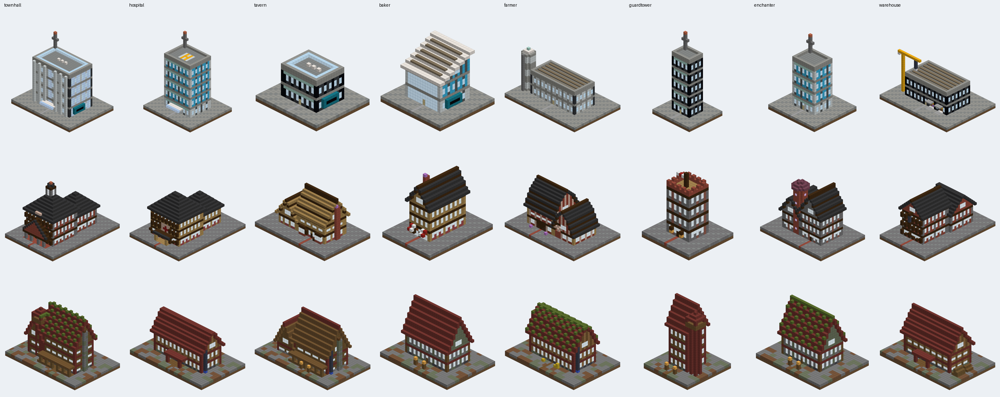
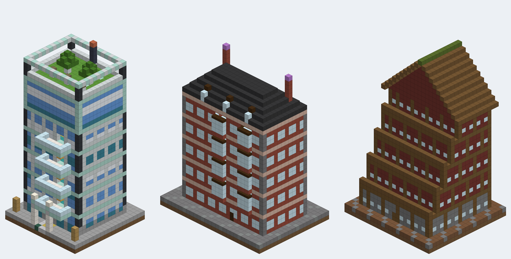

## Every hut as its real-world building (1.14.0)
All regular huts in Neoterra, Hearthwood and Cascadia are now generated from a building **typology**
(`tools/blueprints/neoterra/typology.py`): each hut type gets the plan, roof, storeys, wall treatment and features
of the building it is in real life, added level by level and drawn in the pack's own style (Neoterra modern
concrete and glass with flat roofs, Hearthwood brick and plaster, Cascadia timber and river rock):

| Type | Real-world cues |
|---|---|
| Town hall, university, community college | symmetrical civic hall, portico, clock tower with bell, wings, flag, dome (town hall L5) |
| School, library | bell cupola and flag / portico and dome |
| Hospital | red cross, ambulance canopy, flag, rooftop helipad (flat roofs) |
| Cottage, house, apartment, quadplex | porch, chimney, dormers / stacked balconies, entrance canopy |
| Tavern, restaurant, cookery, bakery | hanging sign, storefront windows, striped awning, terrace tables, oven chimney |
| Builder, stonemason, warehouse, post office | timber or stone stockpiles, yard crane, loading docks |
| Smeltery, stone smeltery, crusher, concrete mixer, mechanic, nether worker | brick/stone/concrete factory hall, smokestacks, bottle kiln, silo |
| Blacksmith, glassblower, dyer, fletcher, alchemist | forge chimney / kiln / dye vats and drying line / targets / apothecary greenhouse |
| Farm, cattle, sheep, pig, chicken, rabbit, stable, composter | red barn boards, X-braced barn doors, hay loft, silo, cupola, compost bins |
| Lumberjack, sawmill | log piles, water wheel |
| Florist, plantation | glass greenhouse roof, flower boxes / sunroom |
| Guard tower, archery, combat academy | stone tower with battlements and flag / targets and lookout |
| Miner | stone pithead with headframe |
| Enchanter, graveyard, mystical site | purple mage tower / chapel with steeple and bell / temple with portico and dome |

Cascadia's university keeps its hand-designed campus hall. The special buildings (`military_real.py`, `skyskin.py`):

| Building | Real-world form |
|---|---|
| Barracks | walled fort: curtain wall with battlements and gate, parade ground with flag and targets, barracks hall with armoury; one corner keep (child hut, 4 bunks per level, ladders, battlements) per level |
| Gatehouse | castle gatehouse: two flanking towers, arched passage with wooden → iron portcullis gate, archers' gallery, bunks |
| Wall guard tower | round (square in Neoterra) bastion tower, stacked floors, bunks and armoury, battlemented top |
| Sky tower | regular high-rise facade – Neoterra white concrete, Hearthwood red-brick mansion block, Cascadia timber tower – paved forecourt |

The bunker stays underground behind its blast-door entrance.

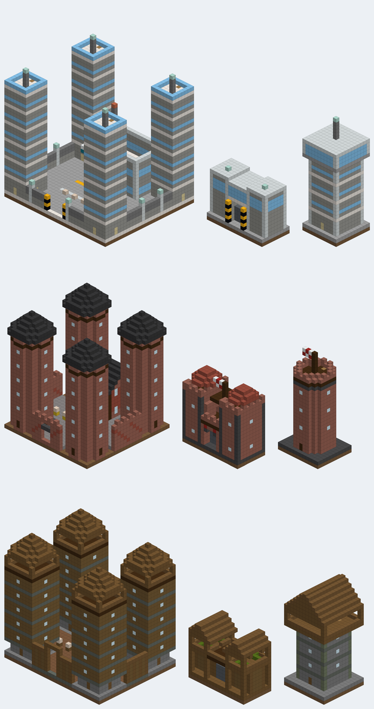

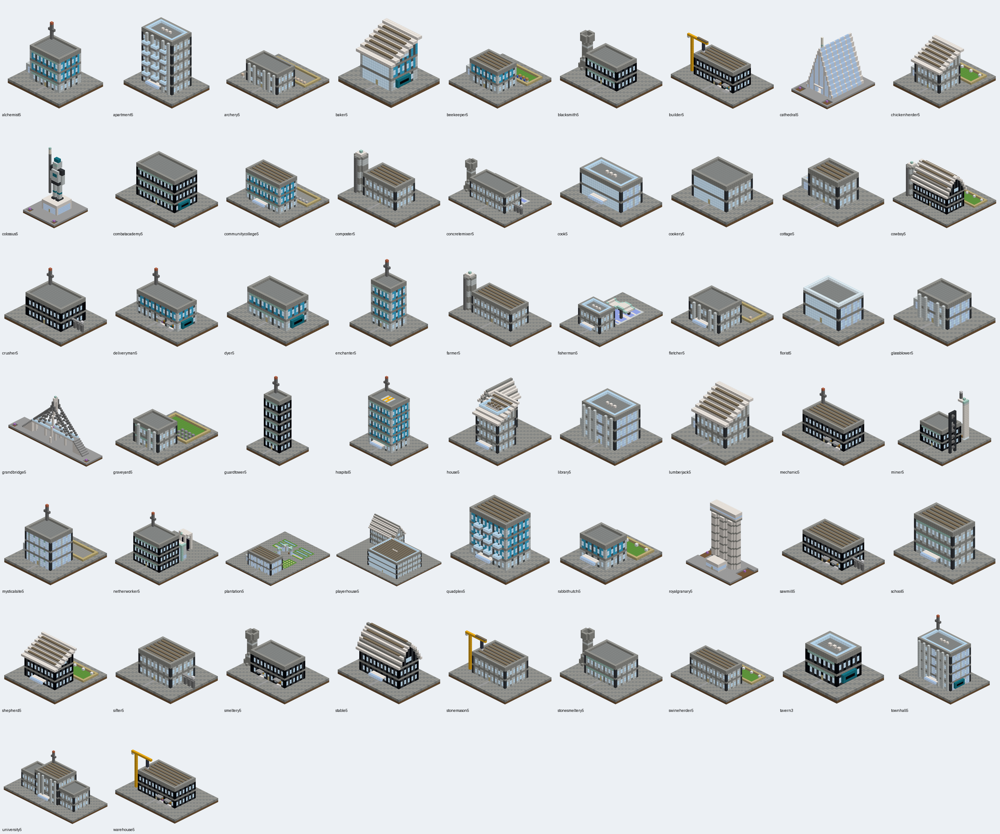
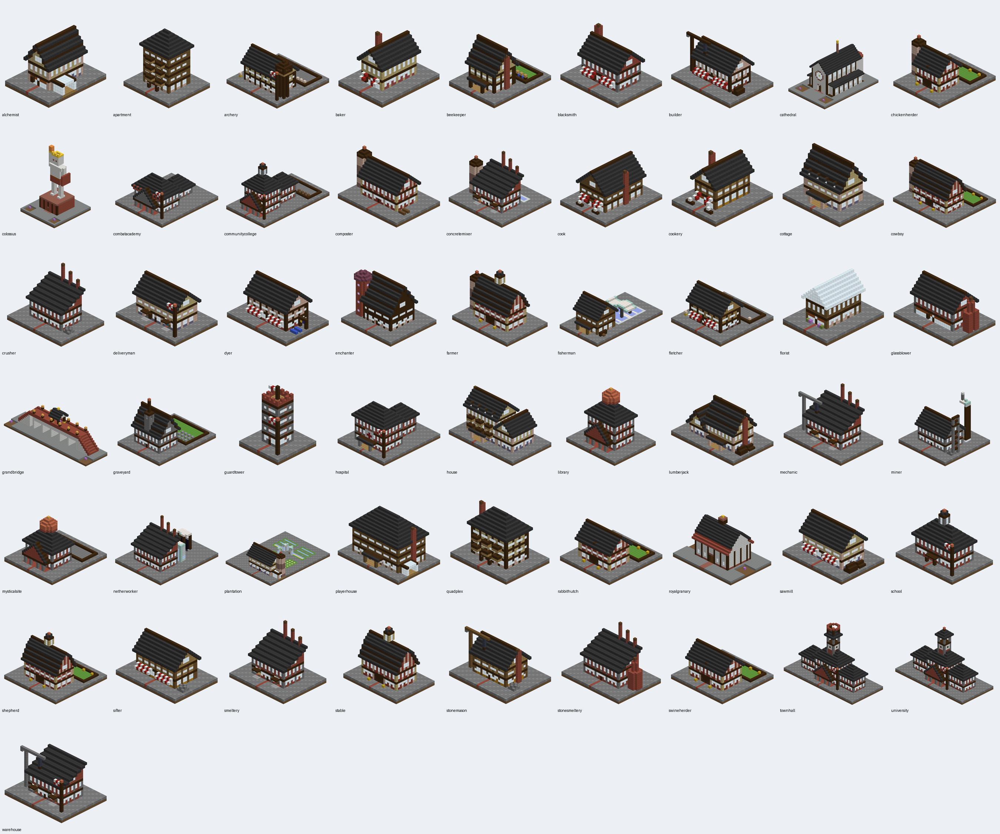
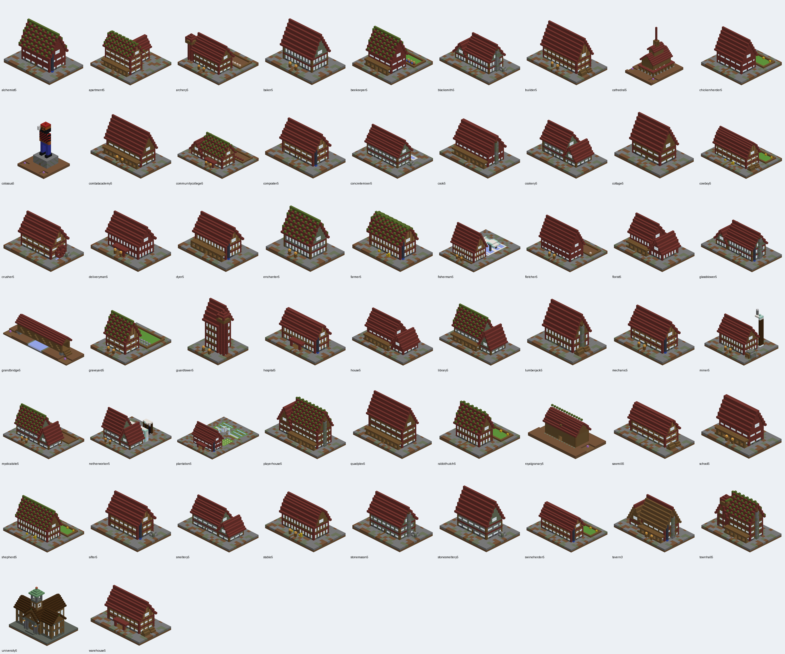

## Farmworks – automatic farms + the Trade Post
The fourth pack in the jar. Every farm uses mechanics that need no timing-sensitive redstone:

| Farm | How it works |
|---|---|
| Mob tower | dark spawning platform 25 blocks up, water channels push mobs into the drop shaft, the fall kills them, hoppers collect into chests (stay within 24-128 blocks) |
| Iron farm | 3 villager pods + zombie cell above a spawning floor; water pushes golems under a sign-held lava blade, drops fall into a floor hopper and chest (bring the villagers and a name-tagged zombie) |
| Cactus farm | three tiers of cactus on fence-supported sand break themselves on fence posts; a water stream carries drops to a hopper row and chest |
| Egg farm | chicken coop floored with hoppers – eggs and feathers go straight into chests (throw in a few eggs to start) |
| Auto kitchen | six hopper-fed smokers: raw food in the top chest, fuel in the side chest, cooked food in the front chests |
| Super smelter | the same layout with four furnaces for ores, sand and kelp |
| Bone-meal line | hopper-fed composters: seeds/crops in, bone meal out |

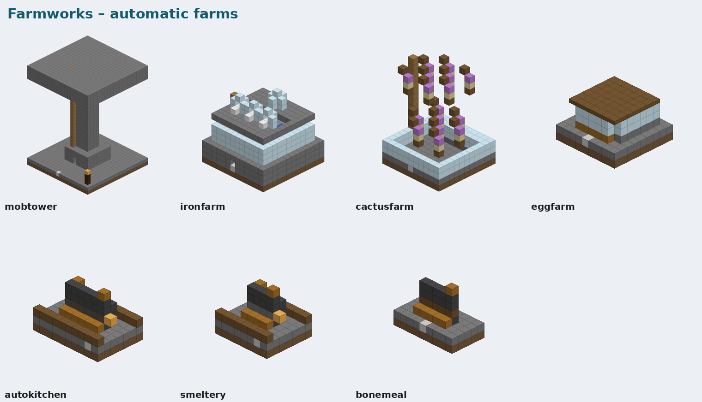

## Trade Post – trade between your colonies (mod code in `mod/`)
The jar also contains a small MineColonies add-on: the **Trade Post** hut (`neoterra:blockhuttradepost`, blueprints
`Farmworks/trade/tradepost1-5`) with the **Trade Courier** job, and the **Trade Ledger** item.

1. Build a Trade Post in two of your colonies (recipe: spruce planks around a golden build tool and a compass).
2. Craft a Trade Ledger (book + compass + gold ingot). Use it on the first post, then on the post in the other colony – they are linked.
3. Sneak-use the ledger on a post to switch it between *import & export*, *export only* and *import only*.
4. Hire a Trade Courier at every post that should export.

How it works: requests a colony can't fulfil itself (the ones that end up "waiting for the player" or being retried)
are copied by its post to the partner post. The partner colony makes or fetches them like any other request
(stonemason, sawmill, warehouse, …) and its couriers deliver them to its Trade Post. The Trade Courier packs a finished
order and sets off (the citizen is away for the round trip – 20 s to 10 min each way depending on distance, shorter at higher post
levels); on arrival the goods are put into the building that asked for them and the original request is closed. Goods
for an order are kept in the post until the courier leaves. Each post level allows 4 more open orders.

| Level | Trade Post |
|---|---|
| 1 | open timber market stall, 2 racks |
| 2 | closed oak store, cartography table, 4 racks |
| 3 | spruce depot, hay cart and hitching rail, 6 racks |
| 4 | stone-and-spruce trading house, bell, 8 racks |
| 5 | deepslate & copper caravanserai with lookout tower and loading awning, 10 racks |

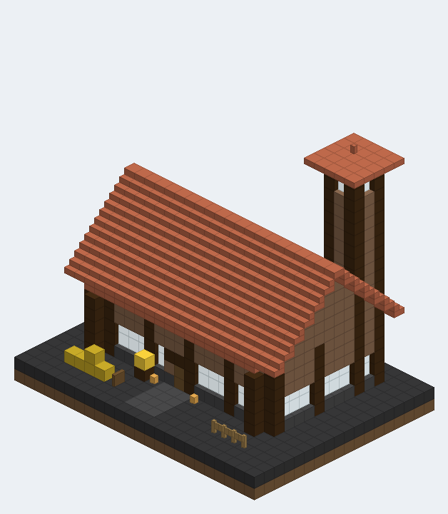

## Builder fixes, Supply Depot and Grand Projects (also in the jar)

**Settings** – `serverconfig/neoterra-server.toml` in the world folder (created on first start):

| Setting | Default | What it does |
|---|---|---|
| `builders.upfrontMaterials` | true | builders request the whole missing material list at once instead of stage by stage |
| `huts.supplyDepot` | true | Supply Depot on/off |
| `huts.tradePost` | true | Trade Post on/off |
| `wonders.wonderBonus` | 1.0 | strength of Grand Project bonuses (0 = off) |

**Up-front materials** – as soon as a builder has worked out a build's material list, everything still missing is
requested in one go, so the warehouse, crafters, Supply Depot and Trade Post work on all of it in parallel and
the builder doesn't stall between stages.

**Faster crafting queues (University research)** – three new entries in the University's *Technology* branch.
Each one makes every crafter (stonemason, sawmill, blacksmith, …) finish each craft a little sooner, so orders
spend less time waiting in crafting queues:

| Research | Needs | Cost | Crafters |
|---|---|---|---|
| Efficient Benches | sawmill level 1 | 8 crafting tables | +5% faster |
| Workshop Rhythm | stonemason level 2 | 16 iron ingots | +10% faster |
| Master Artisans | university level 3 | 8 gold ingots, 16 books | +15% faster |

**Supply Depot** (Farmworks → `trade/supplydepot1-5`, hut `neoterra:blockhutsupplydepot`, job Quartermaster) – takes
requests nobody in the colony makes (the ones that would land on you), picks the simplest crafting recipe,
requests its ingredients from the colony, crafts the items and walks them to whoever asked. 3 open orders per
level. It has priority over the Trade Post: the colony makes what it can before trading for it.

**Grand Projects** – a new *wonders* tab in Neoterra, Hearthwood and Cascadia, each in the pack's own style. Every
wonder has two **wing** huts (child buildings), so up to three builders can work on it at once; the bonus counts
the lowest level of the core and both wings, and adds to MineColonies' own research effects.

| Wonder | Wings | Bonus per completed level |
|---|---|---|
| Cathedral | two bell towers | +3% happiness, +10% regeneration, +1 citizen HP |
| Grand Bridge | two end pylons | +3% walking speed, Trade Couriers 8% faster |
| Colossus | two fire braziers | guards +0.4 damage and +4% armour |
| Royal Granary | two silos | meals +5% saturation |

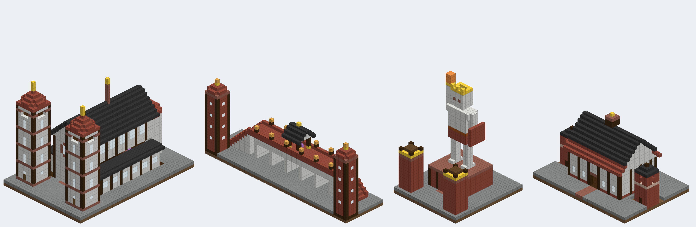

Build the mod: `cd mod && gradle jar` (NeoForge 21.1 / ModDevGradle, MineColonies 1.1.1420). `gradle runServer` boots a dev
server with a self-test: two colonies trade a request, the Supply Depot crafts one, a wonder bonus is applied and removed
(builder speed left alone), the University research line loads, a builder requests its materials up front, and all 130 hut blueprints load through
Structurize (`SELFTEST PASS`).

## Install (CurseForge / any NeoForge 1.21.1 instance)
- **Easiest:** put `dist/Neoterra-1.19.0.jar` into the instance's `mods` folder (CurseForge: right-click the
  profile → *Open Folder* → `mods`). It is a NeoForge mod that carries the Trade Post and all four style packs (Neoterra, Hearthwood, Cascadia and Farmworks);
  MineColonies, Structurize and Domum Ornamentum must be installed.
- `dist/Neoterra-1.19.0.zip` is the download bundle: it contains the jar (extract it, then copy the jar to `mods`).
- Rebuild both with `python3 tools/blueprints/neoterra/package.py <version>` (compiles `mod/` with Gradle).

## Install
Copy `stylepacks/Neoterra` into `.minecraft/blueprints/` (so you get
`.minecraft/blueprints/Neoterra/pack.json`), restart, and pick **Neoterra** in the Build Tool / supply camp.

## Buildings

### Town hall (`fundamentals/townhall1-5`) – 45 × 62 × 45, same footprint every level
| Level | Adds | Player use |
|---|---|---|
| 1 Founding Hall | Round glass podium, reception with the hut block, stair core to a roof terrace | Crafting table, 2 furnaces, 4 barrels, bed (respawn) |
| 2 Civic Ring | Second-floor ring building with cyan band, planted green-roof ring, lawn ring with 8 trees | Full workshop: smithing table, stonecutter, grindstone, anvil, loom, cartography & fletching tables, blast furnace, smoker, furnace, brewing stand, water cauldron, 10 barrels |
| 3 Archive Tower | Two-storey glass tower, balcony | Enchanting library (max level enchants: 30 bookshelves), lectern, anvil, grindstone, 4 beds |
| 4 Sky Lounge | Glass sky lounge, roof deck, plaza fountains; premium upgrade (light-blue glass, quartz, DO pillars, eaves and recessed lights, light-strip ring) | Ender chest, jukebox, bar; **glass bubble-column elevator** from the lobby (copper door) straight to the roof deck |
| 5 Spire | Glowing halo ring, light fins, lamp spires, roof garden with trees, tapered spire with antenna | **Elytra launch pad** cantilevered off the roof deck (~40 blocks up) |

Approximate blocks: L1 ≈ 3.8k, L2 ≈ 5.1k, L3 ≈ 7.6k, L4 ≈ 9.0k, L5 ≈ 9.4k (mostly concrete and glass).
Levels 1–3 are the cheaper versions (plain glass, gray concrete, cyan concrete accents, smooth
stone, lanterns, glass-pane railings); the premium look (light-blue glass, polished deepslate, quartz, sea lanterns,
Domum Ornamentum lights and railings, glowing light strips) arrives at level 4 and is completed
at level 5.
(`CHEAP_UNTIL` in `common.py` controls this.)

### Builder's hut (`fundamentals/builder1-5`) – 29 × 28 × 25, same footprint every level
Hut block: `minecolonies:blockhutbuilder`. A fabrication hub: a glass lobby carrying a floating
upper box on slim pilotis, a sky box stacked on top and cantilevered over the entrance (L4+),
and a fabrication yard where a 3D-printing gantry prints a concrete pod that grows every level.

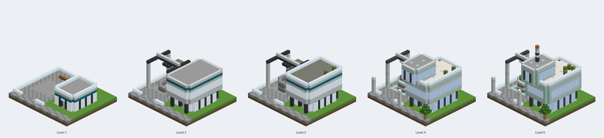

| Level | Racks | Adds | Player use |
|---|---|---|---|---|
| 1 Lobby | 8 | Glass lobby with chamfered corners, hut behind a counter, fenced yard | Crafting & cartography tables, barrels |
| 2 Floating Studio | 11 | Cantilevered upper box with ribbon window, 3D-printing gantry + first printed ring, covered racks | Stonecutter, grindstone, anvil, smithing table; design studio (bookshelves, lectern, drawing tables) |
| 3 Roof Deck | 22 | Roof deck + ladder, taller printed pod | Roof access |
| 4 Sky Box (premium) | 33 | Stacked glass sky box cantilevered over the entrance, glowing light strips (soffits, bands, gantry), glowing print nozzle, light columns, tree | **Architect's Cutter**, bed, jukebox, sky lounge seats |
| 5 Landmark | 44 | Printed pod finished with a glass oculus, glowing box edges, roof garden, antenna spire | Ender chest |

### Residences (`fundamentals/cottage1-5`, `house1-5`, `apartment1-5`, `quadplex1-5`)
Hut block: `minecolonies:blockhutcitizen`. Four variants of the same hut; a residence of level N
has N beds. Every flat/house has its own kitchen (furnace, smoker, crafting table, barrel) and seats.


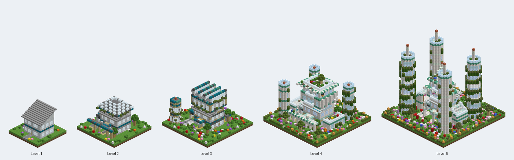
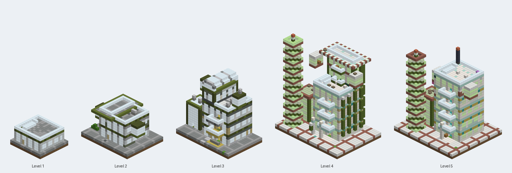
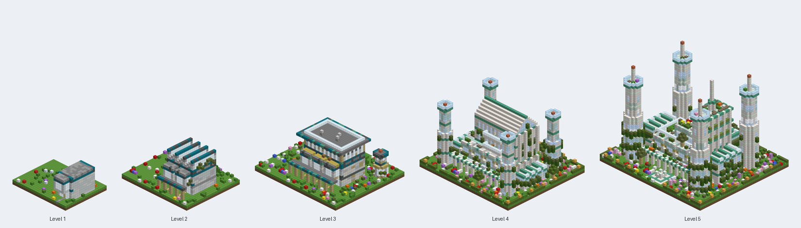

| | Cottage (19 × 16 × 19) | House (21 × 19 × 21) | Apartment (17 × 34 × 19) | Quadplex (27 × 18 × 21) |
|---|---|---|---|
| Idea | Single-family home, cantilevered flat roof, glass front, garden | Regular two-storey family house, sloping roof, garage | Block that grows one storey per level, one flat per storey, stair core | Row of four townhouses with cantilevered glass bay windows |
| L1 | House: kitchen, dining, 1 bed | Kitchen, living, dining, master bedroom upstairs | Ground-floor flat + entrance with the hut | Townhouse 1 (kitchen downstairs, bedroom upstairs) |
| L2 | Bedroom wing, trees | Garage workshop (anvil, smithing table, grindstone), driveway, porch canopy, 2nd bedroom | 2nd storey, trees | Townhouse 2, back-garden trees |
| L3 | Glass loft with stairs, roof terrace, hedge | Back deck with pergola and outdoor table, hedge, 3rd bedroom | 3rd storey, balconies + ground patio | Townhouse 3, hedge dividers |
| L4 | Premium; pool, vegetable garden (carrots/potatoes on farmland), lamp spires | Premium; guest room, garage roof terrace, hot tub, lamp spires | 4th storey, premium, roof garden with seats | Townhouse 4, premium, lamp spires |
| L5 | Roof garden on the wing, glowing loft, jukebox | Attic loft bed under the high roof (ladder), ender chest, jukebox | Penthouse storey, roof trees, mast, ender chest | Glass penthouse on the roof (ladder from townhouse 2), roof terrace, ender chest, jukebox |

### Skytower – apartment tower with penthouse, up to 25 residents (`fundamentals/skytower1-5`)
19 × 40 × 19. MineColonies caps one residence hut at 5 residents, so the Skytower contains
**five residence huts**: the tower's own hut in the lobby (its residents live in the glass
penthouse) plus one child residence hut on each of the 4 apartment floors — the same mechanism
the official barracks use for their towers. Upgrade each floor's hut on its own (it builds
`skytowerflat1-5`, tagged invisible so it does not clutter the Build Tool). 5 × 5 = 25 beds max.

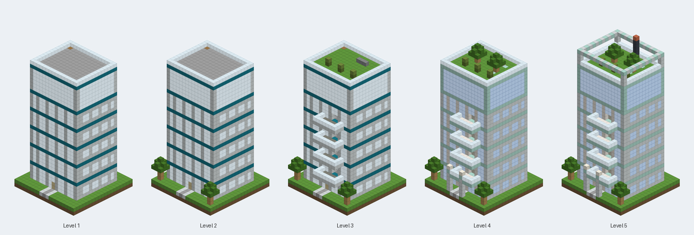

| Tower level | Adds | Penthouse beds |
|---|---|---|
| 1 | Full tower shell, stair core through all floors, lobby with parcel boxes, glass penthouse, roof railing | 1 |
| 2 | Lobby seating and planters, trees | 2 |
| 3 | Balconies on every apartment floor, roof garden with planters and seats | 3 |
| 4 | Premium palette, roof-garden trees, lamp spires | 4 |
| 5 | Glowing crown around the roof, antenna mast | 5 |

Each apartment (`skytowerflat`, levels 1–5): 1–5 beds, kitchen (furnace, smoker, crafting table,
barrel), dining table; sofa (L2), planter (L3), bookshelves + jukebox (L4), ender chest (L5).
Inside the tower blueprint the apartment interiors are `structurize:blocksubstitution`, so
upgrading the tower never overwrites the apartments.

### Player house (`decorations/housing/playerhouse1-5`) – decoration, no hut, 5 upgrade levels
35 × 22 × 29. Uses MineColonies' decoration controller (like the official player mansion): a
builder builds it, it is not a colony building, and its controller block offers **Upgrade** to
the next `playerhouseN`.


| Level | Adds |
|---|---|
| 1 | Ground floor: workshop (2 furnaces, crafting table), entrance hall with a bed, storage wall (13 barrels), roof terrace |
| 2 | Full workshop (4 furnaces, 2 blast furnaces, 2 smokers, smithing table, stonecutter, loom, cartography & fletching tables, anvil), storage vault (~120 barrels), irrigated farm, composter, lectern, trees |
| 3 | Floating upper floor: enchanting library (30 bookshelves), bedroom (2 beds), brewing station, lounge; pool; roof terrace seats |
| 4 | Premium palette; beacon on a 3×3 iron-block base, roof garden, nether portal frame, ender chest, jukebox, lamp spires |
| 5 | Roof lounge seats, glowing corners |

### Bunker – four-deck underground settlement with a player base (`fundamentals/bunker1-5`)
41 × 32 × 41, almost entirely underground (lawn on top; the ground around the shell and any deck
not built yet is `blocksolidsubstitution`, so the builder only digs what it needs). A glass atrium
runs through every deck under a skylight. Like the Skytower it contains **child huts**, each
upgraded on its own:

| Deck | Purpose | Rooms |
|---|---|---|
| A (top) | Living | dorm (bunker residence, 1–5 beds), **canteen** (cook hut: 1 furnace/level), **classroom** (school hut: 10 seats), **clinic** (hospital hut: 2 beds/level), commons lounge, stores & laundry |
| B | **Player base** | workshop (up to 4 furnaces + 2 blast furnaces + 2 smokers, crafting/smithing/stonecutter/loom/cartography/fletching), enchanting library (30 bookshelves), storage vault (~150 barrels), player suite (2 beds, 2 brewing stands, cauldron, ender chest from L4), armory, map room |
| C (L2+) | Farm | farm hall with a scarecrow field, **farm office** (farmer hut: racks), compost store, water reservoir |
| D (L3+) | Engineering | second scarecrow field, generator room, water tanks, emergency stores, atrium garden |

L4 adds the premium palette and a glass skylight dome, L5 a glowing ring around the atrium on
every deck and a lit reactor core. Up to 17 beds (5 dorm + 2 player + 10 clinic).


### Work huts – each with its own form
| Building | Hut block | Form | Per level |
|---|---|---|---|
| Restaurant `fundamentals/cook` | blockhutcook | **Halo Bistro**: round dining drum (r10), terrace ring, 2nd dining drum (L3), rooftop bar (L4), glass cupola (L5) | 1 furnace per level, kitchen `work` spots, more tagged seats |
| Forester `fundamentals/lumberjack` | blockhutlumberjack | **Arbor Vault**: glass barrel-vault greenhouse that grows longer, lab, sapling nursery, giant indoor tree (L3) | racks 2→6, more saplings |
| Woodcutter `craftsmanship/carpentry/sawmill` | blockhutsawmill | **Timber Works**: sawtooth-roof factory, saw line, log yard, silo + office mezzanine (L3) | racks, saws, log piles; architect's cutter (L4) |
| Stonemason `craftsmanship/masonry/stonemason` | blockhutstonemason | **Stepped Atelier**: stone ziggurat that gains a tier per level, terraces, crown sculpture (L4) | stonecutters, racks, stone stacks |
| Mechanic `craftsmanship/metallurgy/mechanic` | blockhutmechanic | **Gear Hub**: octagonal copper hub, gear sculpture, robot gantry (L2), satellite pod + glass bridge (L3), radar dish (L4) | racks, copper light ring |


### Education
| Building | Hut block | Per level |
|---|---|---|
| School `education/school` | blockhutschool | **Crescent School** wrapping a playground courtyard (the crescent grows each level, 2 storeys from L3): 10 `sit` seats facing a board + teacher `work` spot, roof garden (L4) |
| Library `education/library` | blockhutlibrary | **Book Tower**: round tower that gains a storey per level, bookshelves 10/30/54/104/121 around the walls, reading tables, enchanting table (L4), glass dome (L5) |
| University `education/university` | blockhutuniversity | research rotunda (bookshelves 4/21/41/46/47), lab wing (furnaces 1/1/3/3/3, brewing), lecture hall (L2), quad with `leisure` spots (L3), glowing dome (L5) |

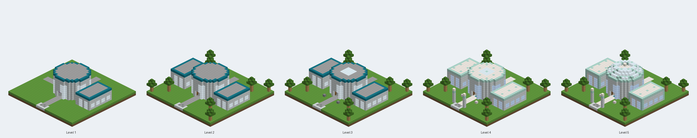

### Military
| Building | Hut block | Per level |
|---|---|---|
| Guard tower `military/guardtower` | blockhutguardtower | 2 beds; grows 12→24 high; ladder to a lookout, glass pod (L4) |
| Barracks `military/barracks` | blockhutbarracks | HQ + courtyard; adds one child **barracks tower** per level (max 4), perimeter wall (L3) |
| Barracks tower `military/barrackstower` | blockhutbarrackstower | child hut: 2 beds per level (one storey each); upgrade from its own hut |
| Archery `military/archery` | blockhutarchery | **Arrow Range**: 45-long range under arched canopies + round bunk tower (2 storeys from L3); 2 beds, 1 target + 1 firing `work` spot per level |
| Combat academy `military/combatacademy` | blockhutcombatacademy | **Colosseum**: sand arena, tiered stands with tagged seats, arcaded outer wall that grows taller; 2 beds per level under the stands, hay dummies 1/2/3/6/9 |
| Stable `military/stable` | blockhutstable | **Equestrian Hall**: barrel-vault riding hall that grows longer + 2-storey stall block; 2 `stall`s per level with hay, loft beds 2/4/4/6/8, paddock |

Counts follow the official MineColonies packs. The gatehouse (a wall gate that needs MineColonies'
gate blocks) is not included yet.


### Support pass (nothing floats)
`support.py` runs after the plot pass in every pack: any group of blocks not connected to the ground gets posts
down to the ground in the pack's trim material, or – if small or if posts would block a path – is removed.

### Plot pass (clean exteriors, tight plots)
`tools/blueprints/neoterra/plot.py` runs last. It removes all landscaping outside the buildings (trees, bushes,
hedges, flowers, grass, vines, window boxes, roof planting and free-standing lamp posts), paves the open ground as
an apron in the building's own colours, and crops every blueprint to the building plus its landmark features with
a 1-block apron – that edge is the road access point for colony roads. Plants inside buildings stay, the
beekeeper keeps its flowers and the animal huts keep their grass pens. The crop is walk-checked (a 2-block apron is
used if 1 would block a door, otherwise nothing is cut). Huts with child buildings, shafts, ponds or wall
alignment (Skytower, barracks, bunker, miner, fisherman, plantation, gatehouse, wall tower) keep their plots.

### Building identities (themes + signature modules)
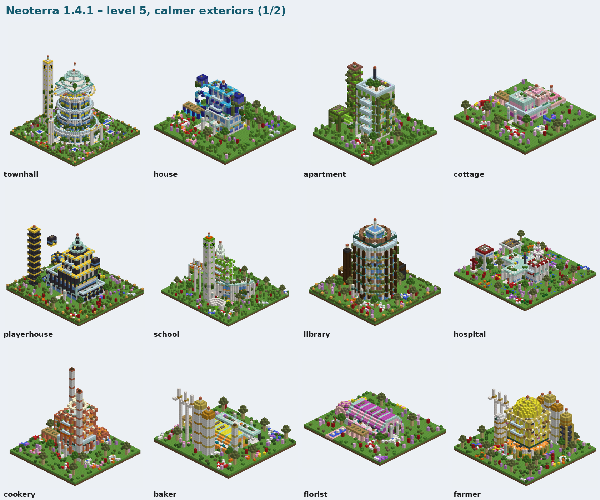
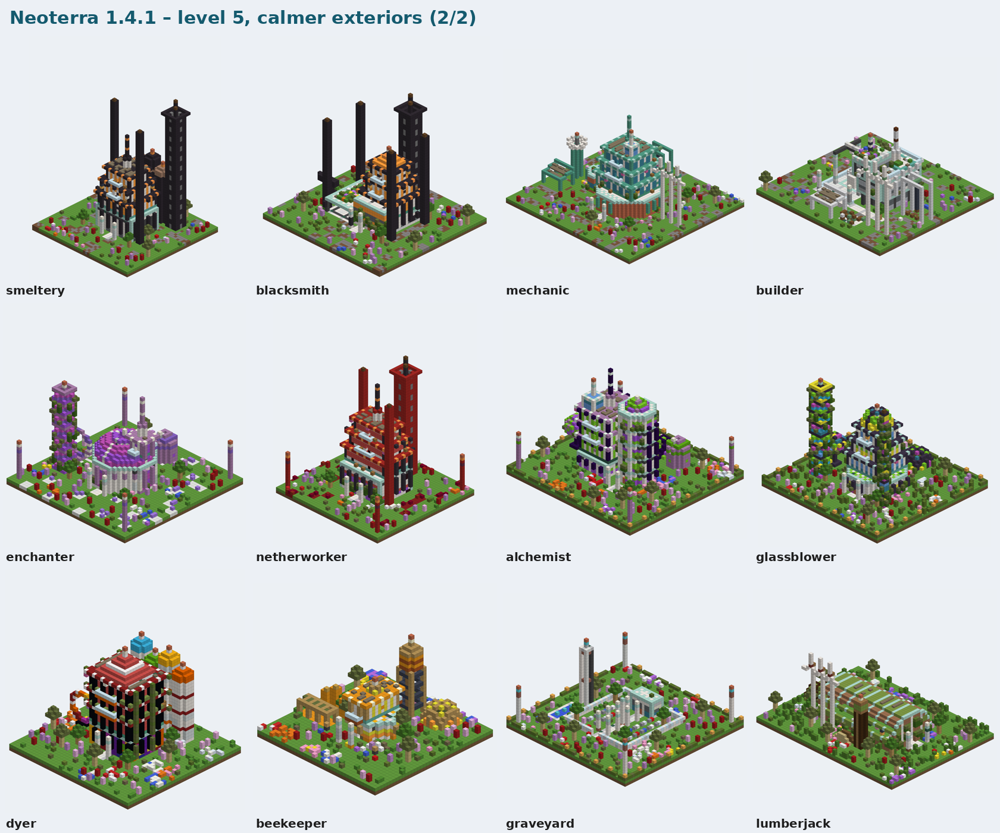
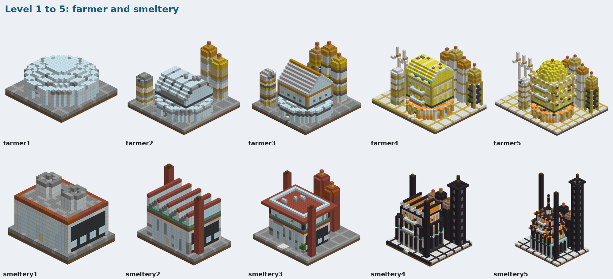

Every hut has its own identity, defined in `tools/blueprints/neoterra/themes.py`:

- **Theme** – its own accent blocks, secondary wall blocks, glass colours, light source, trim and garden style on top
  of the shared Neoterra white. Examples: forge (blackstone, copper, shroomlight – smeltery, blacksmith), bloom
  (cherry, pink – florist, cottage), arcane (purpur, amethyst – enchanter), nether (nether bricks, crimson –
  nether worker), scholar (dark oak, deepslate tiles – library), civic (gold, quartz – town hall), medical
  (red cross accents – hospital), honey (honeycomb – beekeeper), rainbow (dyer), prism (glassblower), copper
  (mechanic), steel (warehouse), ranch / wool / mud / carrot / coop (animal huts) and more – 36 themes.
- **Signature modules** (`signature.py`) – landmark features that appear at a set level and grow afterwards:
  clock tower, bell tower, lighthouse, watch post, silos, water tower, wind turbines, radar dish, observatory,
  greenhouse dome, foundry tower, twisting tower, chimneys, gantry crane, crate yard, log stacks, solar canopy,
  pergola, terraced ziggurat, amphitheatre, sculptures (ring, orb, arch, red cross, anvil, arrow), honeycomb
  pillars, glass atrium, helipad, sky bridge + pavilion, monumental gate, reflecting pools, obelisks, hanging
  gardens and cantilevered glass pods. No two buildings share a recipe.
- **Roof sequence and crown** – each building has its own roof forms for levels 2-4 and its own level-5 crown.
- **Garden style** – meadow, flower fields, orchard, forest, hedges, formal topiary, gravel yard, desert,
  ponds, crystal, crimson or pasture.

### Reshape pass (the main building changes every level)
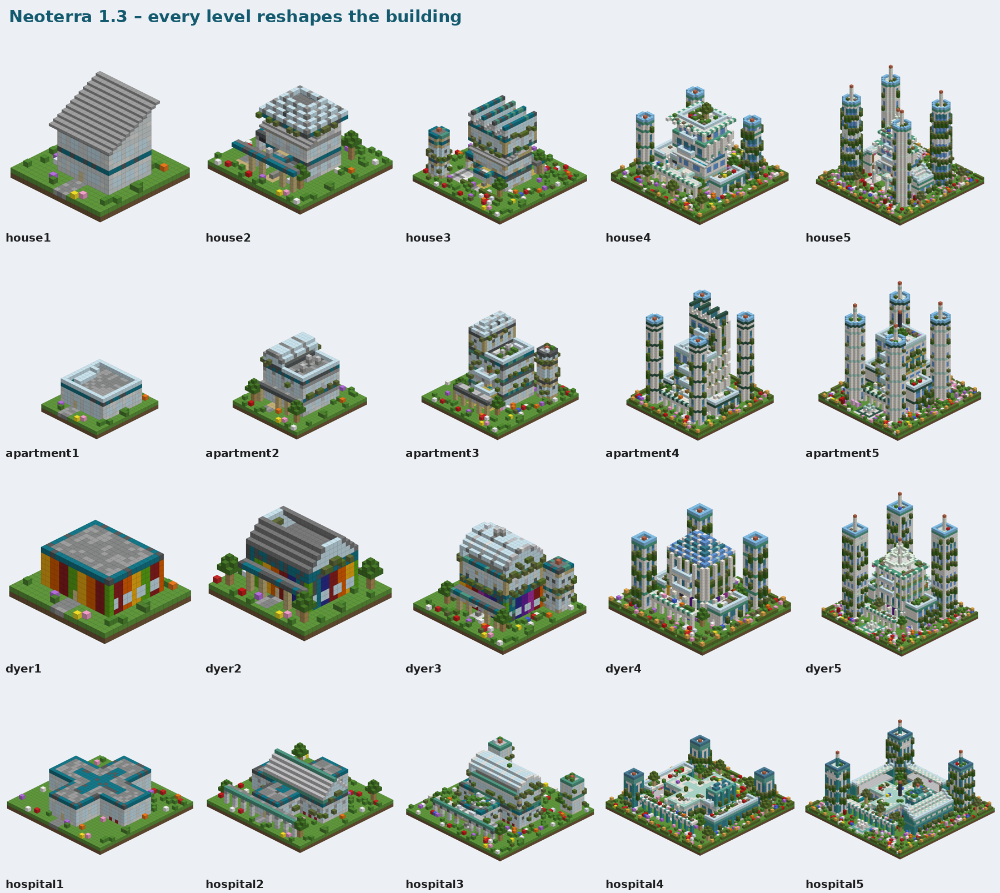

MineColonies upgrades replace every block that differs, so a level does not have to keep the previous shape.
`tools/blueprints/neoterra/reshape.py` runs first and rebuilds the top of each main building per level: it clears
the old roof down to the median wall height (never where anything functional sits), lays a fresh slab, then

| Level | Main building |
|---|---|
| 1 | base building |
| 2 | new roof form |
| 3 | + 1 storey with its own roof form |
| 4 | + 2 storeys (stepped back on some buildings), vertical facade fins, balconies |
| 5 | + 3 storeys with cantilevered glowing slab edges and a crown (glass dome, stepped glass pyramid, halo rings or needle spire) |

Roof forms (gable, barrel vault, hip, sawtooth, overhang deck) rotate per level and per building. New storeys are
reached by a ladder from the floor below. Very tall buildings (24+ blocks) keep their height and only get the roof
or crown; a few vaulted/ring-shaped buildings keep their core and grow through the massing pass instead.

### Massing pass (buildings without a recipe)
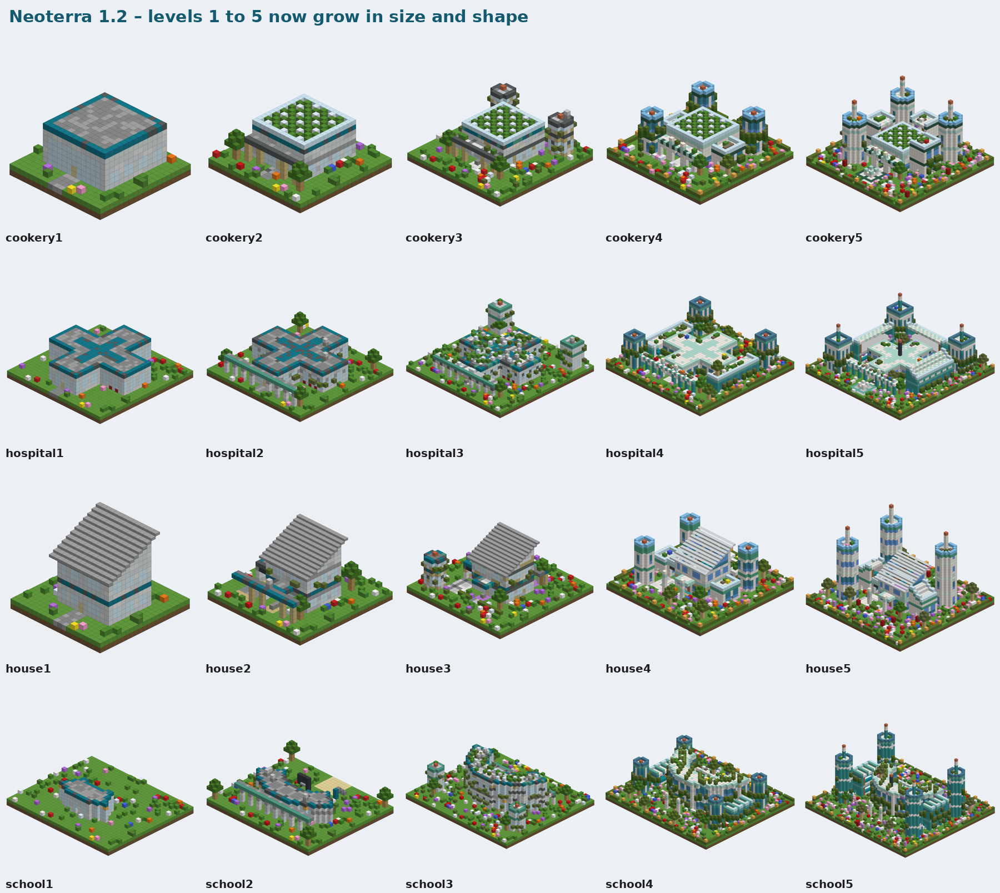

`tools/blueprints/neoterra/massing.py` runs before the detail pass and grows each building's actual shape:

| Level | Added architecture |
|---|---|
| 1 | the core building |
| 2 | entrance canopy |
| 3 | front colonnade (columns or arches) + two corner towers at the back |
| 4 | four corner towers (floors, ladders, doors, roof terraces) + single-storey side wings |
| 5 | taller towers with glowing caps, spires and lightning rods, two-storey side and back wings, front plaza with a fountain |

Every building gets its own variant from its name – tower shape (square / round / octagon / stepped), wing style
(glass hall / stepped terraces / sawtooth roof), colonnade style and material set (tuff bricks, bone blocks,
calcite, oxidised copper, warped stems, froglights, glazed terracotta, deepslate tiles, blackstone bricks...).
The lot grows to fit. Huts with child buildings, tunnels or ponds (Skytower, barracks, bunker, miner, fisherman,
plantation, tavern, gatehouse, wall tower) keep their exact frame. Wings never cover paths, nothing protected is
overwritten and each element is walk-checked and dropped if it would block anything.

### Detail pass (all buildings)
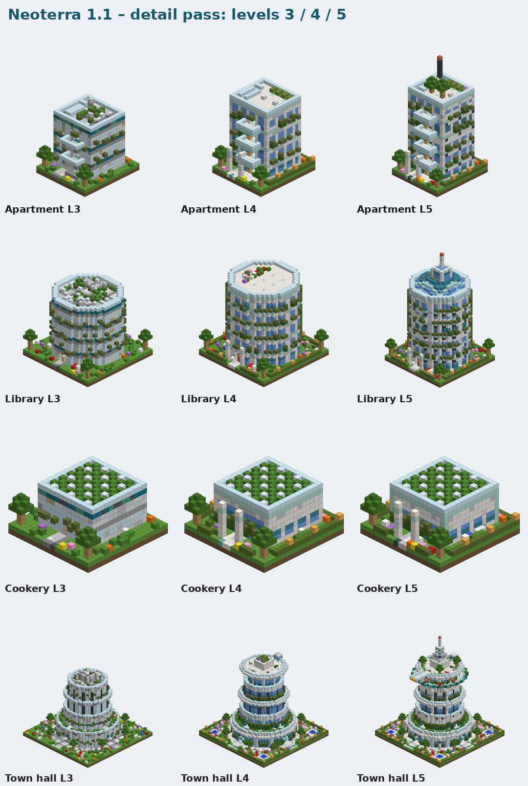

After the generators lay out each building, `tools/blueprints/neoterra/detail.py` enriches every blueprint:
- **Materials** – no fixed palette, just the Neoterra theme: walls mix white concrete, calcite, polished diorite
  and birch panels (L1-3) or smooth quartz, quartz bricks, quartz pillars and chiseled quartz (L4-5); floors get
  tile grids with terracotta / prismarine inlays; cyan accents become terracotta, oxidised copper, copper grates,
  prismarine and dark prismarine; premium glass gets light-blue / cyan / white bands.
- **Facades** – flowering azalea window boxes under upper windows (L2+), hanging vines (L4+).
- **Roofs** – vents (L2-3), moss green roofs (L3), roof gardens, trees and solar arrays (L4-5), glowing roof
  edges (L4-5) and a glass **sky lounge with a spire** on the highest roof at level 5 (the blueprint grows taller).
- **Grounds** – grass and flowers, bushes (L3+), trees, pink petals and a lantern-lit hedge border (L4+),
  tall flowers (L5).
- **Interiors** – potted plants in corners, rugs (L2+), wood floors in homes and schools, plants and candles on
  counters and chiseled bookshelves (L3+), pendant lights and spore blossoms (L4-5).

Block entities, tags and hut requirements are never touched, and each step is walk-checked and rolled back if it
would block a bed, hut block, rack, workstation, seat or guard post. Levels 1-3 stay on cheap blocks.

### Update 1 – colony essentials
| Building | Path | Form | Per level |
|---|---|---|---|
| Supply camp | `decorations/supplies/supplycamp` (+ `camp`) | dome-pod camp round a crate deck, tag-substitution anchor like the official camp | beds, crafting table, furnace, architect's cutter, racks |
| Supply ship | `decorations/supplies/supplyship` (+ `ship`) | catamaran with a glass bridge; floats on 3 water layers | 3 beds, crafting table, furnace, racks |
| Miner | `fundamentals/miner` | **Mine Head**: lattice headframe tower over the shaft (grows each level, sheave wheel on top) + glass hall | `ladder`/`cobble` tags on the shaft, racks, sorting line (L2), ore display (L3) |
| Mine nodes | `infrastructure/mineshafts/miner*` | official tunnel layouts (MineColonies, GPL-3.0) re-skinned in Neoterra materials | – |
| Farmer | `agriculture/horticulture/farmer` | **Agri-Dome**: glass dome barn, seed beds, silo (L2), hay store (L3) | racks, composters |
| Farm fields | `decorations/fields/neofield`, `neofieldlarge` | irrigated 9×9 / 13×13 farmland with a scarecrow | – |
| Hospital | `fundamentals/hospital` | **Cross Clinic**: plus-shaped wards, glowing roof cross | red beds 2/4/6/6/8 (+2 cyan at L4-5), furnace, brewing |
| Tavern (levels 1–3) | `fundamentals/tavern` | **A-Frame Lodge**: steep glass-gabled A-frame, bar, sleeping loft | 8 beds, 8/12/16 tagged seats (+ beer garden L2) |
| Fisherman | `agriculture/husbandry/fisherman` | **Marina**: pond with jetty, wave canopy, boathouse | 4 fishing `work` spots, racks |
| Smeltery | `craftsmanship/metallurgy/smeltery` | **Foundry**: dark block with twin glowing stacks that grow | 1 furnace per level (+ blast furnace L5) |
| Blacksmith | `craftsmanship/metallurgy/blacksmith` | **Forge**: shed-roof hall, forge hood, quench trough, anvil court | anvils, smithing table, racks |
| Baker | `craftsmanship/luxury/baker` | **Bakehouse**: loaf vault + café terrace | 1 furnace per level, café seats |


### Update 2 – production & farming
| Building | Path | Form | Per level |
|---|---|---|---|
| Fletcher | `craftsmanship/carpentry/fletcher` | **Arrow Works**: arrowhead-shaped workshop + covered test lane with a target | fletching tables, racks, barrels |
| Cookery | `craftsmanship/luxury/cookery` | **Test Kitchen**: glass-cube kitchen, roof herb garden (L2+) | furnaces 1/2/3/4/4 + smoker, cooking island |
| Alchemist | `craftsmanship/luxury/alchemist` | **Apothecary Tower**: round glass tower (a floor per level) + nether-wart greenhouse | 1 brewing stand per level, water cauldron, soul sand beds, glow-berry vines (L3) |
| Dyer | `craftsmanship/luxury/dyer` | **Colour Lab**: rainbow-striped facade (more colours per level) | dye vats (water cauldrons), furnace, loom |
| Glassblower | `craftsmanship/luxury/glassblower` | **Glass Pavilion**: all-glass octagon | 1 furnace per level, sand pile, glass-art plinths (L4) |
| Concrete mixer | `craftsmanship/luxury/concretemixer` | **Mixer Plant**: banded silos, conveyor bridge (L3), 60-block mixing basin | racks |
| Crusher | `craftsmanship/masonry/crusher` | **Crusher Mill**: inverted-pyramid hopper that widens each level | gravel / sand / cobble heaps, grindstone, stonecutter |
| Sifter | `craftsmanship/masonry/sifter` | **Sifting Terrace**: stepped terraces with screens, booth on top (gets higher per level) | racks |
| Stone smeltery | `craftsmanship/masonry/stonesmeltery` | **Kiln House**: hall between brick kiln domes with smoking chimneys | 1 furnace per level |
| Florist | `agriculture/horticulture/florist` | **Flower Atrium**: glass vault greenhouse | composted dirt 4/8/12/16/20, flower border |
| Plantation | `agriculture/horticulture/plantation` | **Plantation Park**: round pavilion between cactus, bamboo and sugar-cane beds | tagged cactus 9→18, bamboo 20, sugar cane 10→20 |
| Composter | `agriculture/horticulture/composter` | **Bio Hub**: round green-roof hub | 1 compost barrel per level |
| Beekeeper | `agriculture/husbandry/beekeeper` | **Apiary**: hexagonal pavilion with honeycomb roof in a flower meadow | beehives 1/1/2/2/3 |
| Chicken farmer | `agriculture/husbandry/chickenherder` | **Coop Pods**: dome coops in a fenced yard (1→3 pods) | racks, trough |
| Cowhand | `agriculture/husbandry/cowboy` | **Cattle Barn**: glass vault barn + paddock | troughs, hay, shade canopy (L4) |
| Shepherd | `agriculture/husbandry/shepherd` | **Hill Fold**: round stone fold with a green-roof shelter | loom, hay, trough |
| Swineherd | `agriculture/husbandry/swineherder` | **Sty Row**: sawtooth sty hall + mud yard | troughs, hay, composter |
| Rabbit hutch | `agriculture/husbandry/rabbithutch` | **Burrow Garden**: grass-covered mound with round windows + carrot run | racks, hay |
| Plantation fields | `agriculture/fields/neobamboo`, `neocactus`, `neosugar`, `neokelp` | fenced beds in the official plantation-field format (kelp in a glass tank) | – |


### Update 3 – mystic, defence, education, infrastructure & parks
| Building | Path | Form | Gameplay |
|---|---|---|---|
| Enchanter | `mystic/enchanter` | **Arcane Observatory**: octagonal hall under a glass dome | bookshelf rings grow each level, enchanting table, lecterns, amethyst (L4) |
| Graveyard | `mystic/graveyard` | **Memorial Garden**: walled lawn, chapel, glowing obelisk | named graves 4/8/12/16/20 |
| Mystical site | `mystic/mysticalsite` | **Starstone Circle**: white monoliths round an amethyst crystal (beacon at L5) | 8 tagged seats |
| Nether worker | `mystic/netherworker` | **Rift Lab**: glass hall around an unlit 4×5 obsidian portal | `portal` tag on the frame (light it in game), racks |
| Gatehouse (levels 1–3) | `military/gatehouse` | **Gate Towers**: twin towers joined by an archers' bridge | 4-wide gate (fence gates → iron gate at L3), `gate`, 2×`knight`, 2×`archer` tags, 4 beds |
| Wall guard tower | `military/wallguardtower` | **Wall Tower**: guard tower that plugs into the Neoterra wall walkway | 2 beds, lookout pod (L4) |
| Community college | `education/communitycollege` | **Campus Hall**: L-shaped hall + lecture terrace (university hut) | lecture seats, library corner, outdoor seats |
| Quarries | `infrastructure/mineshafts/simplequarry`, `mediumquarry` | rim + control cabin over the official pit footprint | shafts re-skinned from the official layouts |

Decorations (no hut): `walls/` (straight, inside/outside corner, gate, stairs, watchtower 1–3 — 8-high walls with a walkway),
`infrastructure/roads` (straight, corner, T-junction, crossroads, tree-lined avenue, stairs), `infrastructure/rails`
(straight, corner, rail stop), `infrastructure/canals` (straight, corner, crossing, lock), `infrastructure/bridge`
(ramp, span, pillar), `infrastructure/subway` (tunnel, corner, glass entrance), `infrastructure/boardwalk`
(straight, corner, pier), `infrastructure/cliffclimb` (base, segment, landing — spiral stair tower) and
`decorations/parks` (bench, small/medium/large park, plaza, fountain — with `sit_out`/`stand_out` tags for visitors).

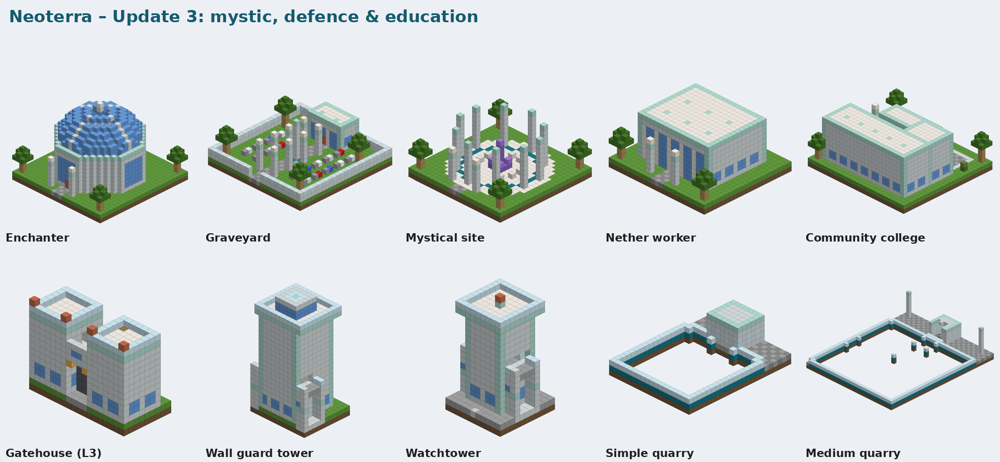


### Courier's hut (`craftsmanship/storage/deliveryman1-5`) – 23 × 22 × 21, same footprint every level
Hut block: `minecolonies:blockhutdeliveryman` (MineColonies calls it the Courier's Hut).


| Level | Adds | Player use |
|---|---|---|
| 1 Depot Hall | Glass depot hall with a 7-wide loading door, reception counter with the hut block | 8 parcel lockers (barrels), crafting table, cartography table |
| 2 Loading Canopy | Canopy on charcoal columns, loading-bay markings, green roof | 21 lockers + 10 storage barrels, lectern, waiting bench |
| 3 Dispatch Office | Upper floor, staircase through a double-height void, roof terrace with planters | Office desks, 12 bookshelves, lectern, cartography table, 10 more lockers |
| 4 Drone Port | Roof drone pad, roof railing + ladder, street trees and lamp spires; premium upgrade (light-blue glass, quartz, light strips, DO lights/railings) | Bed (respawn) |
| 5 Landmark | Full-height quartz fins on side and back facades, terrace trees, antenna mast | Ender chest |

Approximate blocks: L1 ≈ 1.2k, L2 ≈ 1.3k, L3 ≈ 1.7k, L4 ≈ 1.8k, L5 ≈ 2.1k.

### Warehouse (`craftsmanship/storage/warehouse1-5`) – 31 × 20 × 25, same footprint every level
Hut block: `minecolonies:blockhutwarehouse`. Capacity comes from MineColonies racks (single racks,
max 3 high, every rack next to an aisle so couriers can reach it).


| Level | Racks | Adds | Player use |
|---|---|---|---|
| 1 | 36 | Tall distribution hall: clerestory glass band, two 5×5 loading docks, glazed entrance, reception counter | Crafting table |
| 2 | 72 | Dock canopy on charcoal columns, dock bay markings | – |
| 3 | 144 | Office mezzanine reached by stairs, skylights | Desk, crafting & cartography tables, lectern, barrels |
| 4 | 216 | Roof railing + ladder, green roof strips, street trees and lamp spires; premium upgrade (light-blue glass, quartz mullions, light strips, DO lights) | Roof access |
| 5 | 324 | Full-height quartz fins, roof garden with trees, antenna mast | Ender chest |

Approximate blocks (including racks): L1 ≈ 2.0k, L2 ≈ 2.5k, L3 ≈ 2.4k, L4 ≈ 2.7k, L5 ≈ 3.1k.

## Tooling
Blueprints are generated by Python (no hand-scanned files):

```bash
pip install nbtlib pillow
./tools/blueprints/neoterra/build.sh          # build pack + checks + previews
python3 tools/blueprints/validate.py blocks.json stylepacks/Neoterra/**/*.blueprint
```

- `tools/blueprints/blueprint.py` – Structurize `.blueprint` reader/writer
- `tools/blueprints/neoterra/common.py` – Domum Ornamentum blocks, hut block data, geometry
- `tools/blueprints/neoterra/townhall.py` – town hall design (levels 1–5)
- `tools/blueprints/neoterra/builder.py` – builder's hut design (levels 1–5)
- `tools/blueprints/neoterra/residences.py` – cottage, house, apartment and quadplex residences (levels 1–5)
- `tools/blueprints/walkcheck.py` – checks every bed, hut block, rack and workstation is reachable on foot
- `tools/blueprints/neoterra/skytower.py` – Skytower + apartment floors (child residence huts)
- `tools/blueprints/neoterra/playerhouse.py` – player house decoration
- `tools/blueprints/neoterra/kit.py` – shared building kit (shells, stairs, canopies, anchors, child huts)
- `tools/blueprints/neoterra/unique.py` – signature forms (bistro, vault, sawtooth, ziggurat, octagon, crescent, book tower, range, colosseum, riding hall)
- `tools/blueprints/neoterra/education.py`, `military.py`, `bunker.py` – university, guard tower, barracks, bunker
- `tools/blueprints/neoterra/update1.py` – supply camp/ship, miner + mine nodes, farmer + fields, hospital, tavern, fisherman, smeltery, blacksmith, baker
- `tools/blueprints/neoterra/update2.py` – production & farming huts (fletcher … rabbit hutch) + plantation fields
- `tools/blueprints/neoterra/update3.py` – mystic huts, gatehouse, wall guard tower, community college, quarries, walls, roads, rails, canals, bridges, subway, boardwalk, cliff climb, parks
- `tools/blueprints/neoterra/deliveryman.py` – courier's hut design (levels 1–5)
- `tools/blueprints/neoterra/warehouse.py` – warehouse design (levels 1–5)
- `tools/blueprints/neoterra/check_townhall.py` – stair headroom, floor exits, enchanting power, elevator watertightness
- `tools/blueprints/validate.py` – checks every block/property against Minecraft 1.21.1 data
- `tools/blueprints/render.py` – isometric previews and floor plans
- `docs/stylepack-format.md` – notes on the 1.21.1 pack / hut blueprint format
