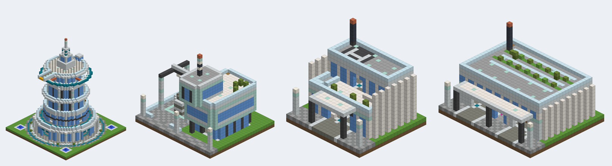
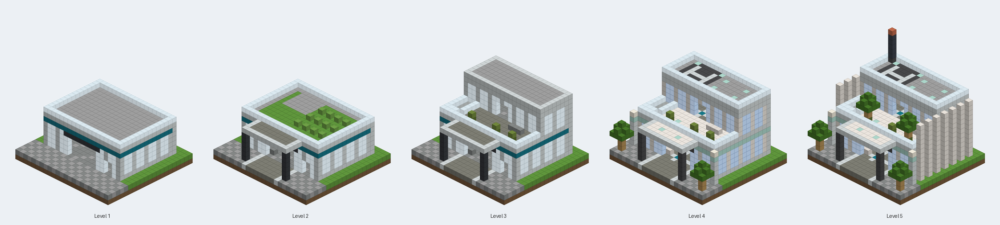

# Neoterra – MineColonies style pack (NeoForge 1.21.1)

Semi-futuristic megastructures: white concrete towers and boxes, light-blue glass, cyan accents,
glowing light strips, halos and spires.
Every building has levels 1–5, grows upward level by level, and is packed with things the player can use.

Requires: MineColonies, Structurize, Domum Ornamentum (all on NeoForge 1.21.1).




## Install
Copy `stylepacks/Neoterra` into `.minecraft/blueprints/` (so you get
`.minecraft/blueprints/Neoterra/pack.json`), restart, and pick **Neoterra** in the Build Tool / supply camp.

## Buildings

### Town hall (`fundamentals/townhall1-5`) – 45 × 62 × 45, same footprint every level
| Level | Adds | Player use |
|---|---|---|
| 1 Founding Hall | Round glass podium, reception with the hut block, stair core to a roof terrace | Crafting table, 2 furnaces, 4 barrels, bed (respawn) |
| 2 Civic Ring | Second-floor ring building with cyan band, planted green-roof ring, lawn ring with 8 trees | Full workshop: smithing table, stonecutter, grindstone, anvil, loom, cartography & fletching tables, blast furnace, smoker, furnace, brewing stand, water cauldron, 10 barrels |
| 3 Archive Tower | Two-storey glass tower, balcony | Enchanting library (max level enchants: 30 bookshelves), lectern, anvil, grindstone, 4 beds |
| 4 Sky Lounge | Glass sky lounge, roof deck, plaza fountains; premium upgrade (light-blue glass, quartz, DO pillars, eaves and recessed lights, light-strip ring) | Ender chest, jukebox, bar; **glass bubble-column elevator** from the lobby (copper door) straight to the roof deck |
| 5 Spire | Glowing halo ring, light fins, lamp spires, roof garden with trees, tapered spire with antenna | **Elytra launch pad** cantilevered off the roof deck (~40 blocks up) |

Approximate blocks: L1 ≈ 3.8k, L2 ≈ 5.1k, L3 ≈ 7.6k, L4 ≈ 9.0k, L5 ≈ 9.4k (mostly concrete and glass).
Levels 1–3 are the cheaper versions (plain glass, gray concrete, cyan concrete accents, smooth
stone, lanterns, glass-pane railings); the premium look (light-blue glass, polished deepslate, quartz, sea lanterns,
Domum Ornamentum lights and railings, glowing light strips) arrives at level 4 and is completed
at level 5.
(`CHEAP_UNTIL` in `common.py` controls this.)

### Builder's hut (`fundamentals/builder1-5`) – 29 × 28 × 25, same footprint every level
Hut block: `minecolonies:blockhutbuilder`. A fabrication hub: a glass lobby carrying a floating
upper box on slim pilotis, a sky box stacked on top and cantilevered over the entrance (L4+),
and a fabrication yard where a 3D-printing gantry prints a concrete pod that grows every level.


| Level | Racks | Adds | Player use |
|---|---|---|---|---|
| 1 Lobby | 8 | Glass lobby with chamfered corners, hut behind a counter, fenced yard | Crafting & cartography tables, barrels |
| 2 Floating Studio | 11 | Cantilevered upper box with ribbon window, 3D-printing gantry + first printed ring, covered racks | Stonecutter, grindstone, anvil, smithing table; design studio (bookshelves, lectern, drawing tables) |
| 3 Roof Deck | 22 | Roof deck + ladder, taller printed pod | Roof access |
| 4 Sky Box (premium) | 33 | Stacked glass sky box cantilevered over the entrance, glowing light strips (soffits, bands, gantry), glowing print nozzle, light columns, tree | **Architect's Cutter**, bed, jukebox, sky lounge seats |
| 5 Landmark | 44 | Printed pod finished with a glass oculus, glowing box edges, roof garden, antenna spire | Ender chest |

### Residences (`fundamentals/cottage1-5`, `house1-5`, `apartment1-5`, `quadplex1-5`)
Hut block: `minecolonies:blockhutcitizen`. Four variants of the same hut; a residence of level N
has N beds. Every flat/house has its own kitchen (furnace, smoker, crafting table, barrel) and seats.


| | Cottage (19 × 16 × 19) | House (21 × 19 × 21) | Apartment (17 × 34 × 19) | Quadplex (27 × 18 × 21) |
|---|---|---|---|
| Idea | Single-family home, cantilevered flat roof, glass front, garden | Regular two-storey family house, sloping roof, garage | Block that grows one storey per level, one flat per storey, stair core | Row of four townhouses with cantilevered glass bay windows |
| L1 | House: kitchen, dining, 1 bed | Kitchen, living, dining, master bedroom upstairs | Ground-floor flat + entrance with the hut | Townhouse 1 (kitchen downstairs, bedroom upstairs) |
| L2 | Bedroom wing, trees | Garage workshop (anvil, smithing table, grindstone), driveway, porch canopy, 2nd bedroom | 2nd storey, trees | Townhouse 2, back-garden trees |
| L3 | Glass loft with stairs, roof terrace, hedge | Back deck with pergola and outdoor table, hedge, 3rd bedroom | 3rd storey, balconies + ground patio | Townhouse 3, hedge dividers |
| L4 | Premium; pool, vegetable garden (carrots/potatoes on farmland), lamp spires | Premium; guest room, garage roof terrace, hot tub, lamp spires | 4th storey, premium, roof garden with seats | Townhouse 4, premium, lamp spires |
| L5 | Roof garden on the wing, glowing loft, jukebox | Attic loft bed under the high roof (ladder), ender chest, jukebox | Penthouse storey, roof trees, mast, ender chest | Glass penthouse on the roof (ladder from townhouse 2), roof terrace, ender chest, jukebox |

### Courier's hut (`craftsmanship/storage/deliveryman1-5`) – 23 × 22 × 21, same footprint every level
Hut block: `minecolonies:blockhutdeliveryman` (MineColonies calls it the Courier's Hut).



| Level | Adds | Player use |
|---|---|---|
| 1 Depot Hall | Glass depot hall with a 7-wide loading door, reception counter with the hut block | 8 parcel lockers (barrels), crafting table, cartography table |
| 2 Loading Canopy | Canopy on charcoal columns, loading-bay markings, green roof | 21 lockers + 10 storage barrels, lectern, waiting bench |
| 3 Dispatch Office | Upper floor, staircase through a double-height void, roof terrace with planters | Office desks, 12 bookshelves, lectern, cartography table, 10 more lockers |
| 4 Drone Port | Roof drone pad, roof railing + ladder, street trees and lamp spires; premium upgrade (light-blue glass, quartz, light strips, DO lights/railings) | Bed (respawn) |
| 5 Landmark | Full-height quartz fins on side and back facades, terrace trees, antenna mast | Ender chest |

Approximate blocks: L1 ≈ 1.2k, L2 ≈ 1.3k, L3 ≈ 1.7k, L4 ≈ 1.8k, L5 ≈ 2.1k.

### Warehouse (`craftsmanship/storage/warehouse1-5`) – 31 × 20 × 25, same footprint every level
Hut block: `minecolonies:blockhutwarehouse`. Capacity comes from MineColonies racks (single racks,
max 3 high, every rack next to an aisle so couriers can reach it).


| Level | Racks | Adds | Player use |
|---|---|---|---|
| 1 | 36 | Tall distribution hall: clerestory glass band, two 5×5 loading docks, glazed entrance, reception counter | Crafting table |
| 2 | 72 | Dock canopy on charcoal columns, dock bay markings | – |
| 3 | 144 | Office mezzanine reached by stairs, skylights | Desk, crafting & cartography tables, lectern, barrels |
| 4 | 216 | Roof railing + ladder, green roof strips, street trees and lamp spires; premium upgrade (light-blue glass, quartz mullions, light strips, DO lights) | Roof access |
| 5 | 324 | Full-height quartz fins, roof garden with trees, antenna mast | Ender chest |

Approximate blocks (including racks): L1 ≈ 2.0k, L2 ≈ 2.5k, L3 ≈ 2.4k, L4 ≈ 2.7k, L5 ≈ 3.1k.

## Tooling
Blueprints are generated by Python (no hand-scanned files):

```bash
pip install nbtlib pillow
./tools/blueprints/neoterra/build.sh          # build pack + checks + previews
python3 tools/blueprints/validate.py blocks.json stylepacks/Neoterra/**/*.blueprint
```

- `tools/blueprints/blueprint.py` – Structurize `.blueprint` reader/writer
- `tools/blueprints/neoterra/common.py` – Domum Ornamentum blocks, hut block data, geometry
- `tools/blueprints/neoterra/townhall.py` – town hall design (levels 1–5)
- `tools/blueprints/neoterra/builder.py` – builder's hut design (levels 1–5)
- `tools/blueprints/neoterra/residences.py` – cottage, house, apartment and quadplex residences (levels 1–5)
- `tools/blueprints/walkcheck.py` – checks every bed, hut block, rack and workstation is reachable on foot
- `tools/blueprints/neoterra/deliveryman.py` – courier's hut design (levels 1–5)
- `tools/blueprints/neoterra/warehouse.py` – warehouse design (levels 1–5)
- `tools/blueprints/neoterra/check_townhall.py` – stair headroom, floor exits, enchanting power, elevator watertightness
- `tools/blueprints/validate.py` – checks every block/property against Minecraft 1.21.1 data
- `tools/blueprints/render.py` – isometric previews and floor plans
- `docs/stylepack-format.md` – notes on the 1.21.1 pack / hut blueprint format
