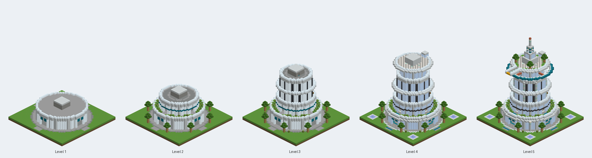
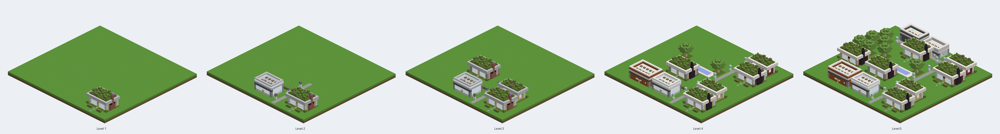
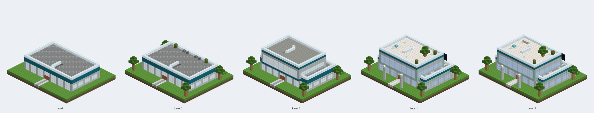
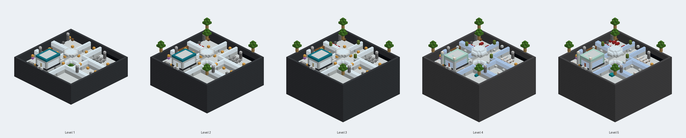
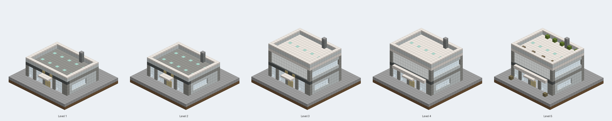
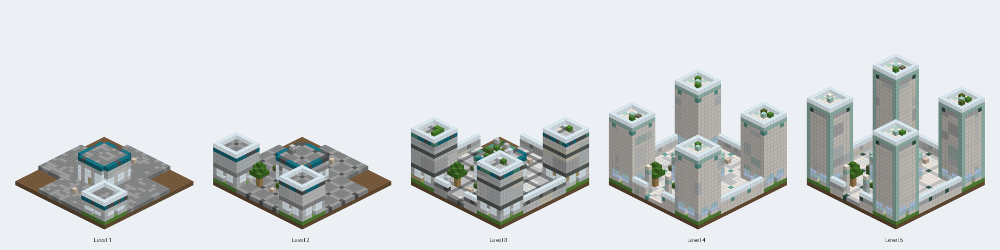
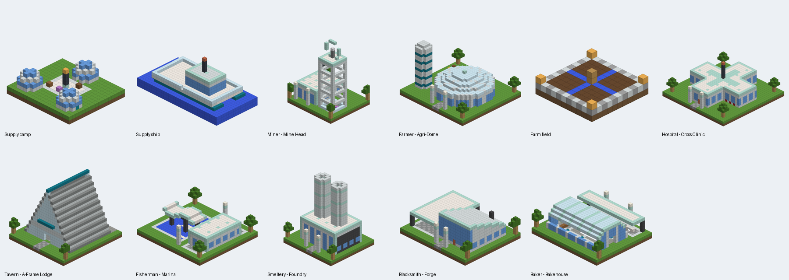
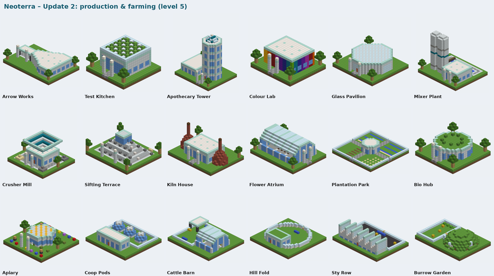
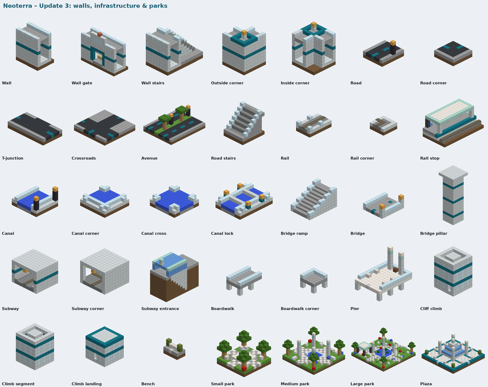
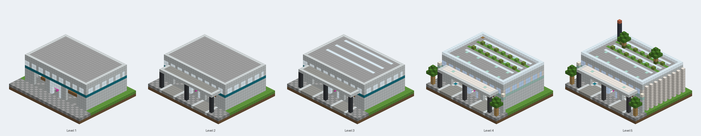

# Neoterra – MineColonies style pack (NeoForge 1.21.1)

Semi-futuristic megastructures: white concrete towers and boxes, light-blue glass, cyan accents,
glowing light strips, halos and spires.
Every building has levels 1–5, grows upward level by level, and is packed with things the player can use.

Requires: MineColonies, Structurize, Domum Ornamentum (all on NeoForge 1.21.1).




## Install
Copy `stylepacks/Neoterra` into `.minecraft/blueprints/` (so you get
`.minecraft/blueprints/Neoterra/pack.json`), restart, and pick **Neoterra** in the Build Tool / supply camp.

## Buildings

### Town hall (`fundamentals/townhall1-5`) – 45 × 62 × 45, same footprint every level
| Level | Adds | Player use |
|---|---|---|
| 1 Founding Hall | Round glass podium, reception with the hut block, stair core to a roof terrace | Crafting table, 2 furnaces, 4 barrels, bed (respawn) |
| 2 Civic Ring | Second-floor ring building with cyan band, planted green-roof ring, lawn ring with 8 trees | Full workshop: smithing table, stonecutter, grindstone, anvil, loom, cartography & fletching tables, blast furnace, smoker, furnace, brewing stand, water cauldron, 10 barrels |
| 3 Archive Tower | Two-storey glass tower, balcony | Enchanting library (max level enchants: 30 bookshelves), lectern, anvil, grindstone, 4 beds |
| 4 Sky Lounge | Glass sky lounge, roof deck, plaza fountains; premium upgrade (light-blue glass, quartz, DO pillars, eaves and recessed lights, light-strip ring) | Ender chest, jukebox, bar; **glass bubble-column elevator** from the lobby (copper door) straight to the roof deck |
| 5 Spire | Glowing halo ring, light fins, lamp spires, roof garden with trees, tapered spire with antenna | **Elytra launch pad** cantilevered off the roof deck (~40 blocks up) |

Approximate blocks: L1 ≈ 3.8k, L2 ≈ 5.1k, L3 ≈ 7.6k, L4 ≈ 9.0k, L5 ≈ 9.4k (mostly concrete and glass).
Levels 1–3 are the cheaper versions (plain glass, gray concrete, cyan concrete accents, smooth
stone, lanterns, glass-pane railings); the premium look (light-blue glass, polished deepslate, quartz, sea lanterns,
Domum Ornamentum lights and railings, glowing light strips) arrives at level 4 and is completed
at level 5.
(`CHEAP_UNTIL` in `common.py` controls this.)

### Builder's hut (`fundamentals/builder1-5`) – 29 × 28 × 25, same footprint every level
Hut block: `minecolonies:blockhutbuilder`. A fabrication hub: a glass lobby carrying a floating
upper box on slim pilotis, a sky box stacked on top and cantilevered over the entrance (L4+),
and a fabrication yard where a 3D-printing gantry prints a concrete pod that grows every level.


| Level | Racks | Adds | Player use |
|---|---|---|---|---|
| 1 Lobby | 8 | Glass lobby with chamfered corners, hut behind a counter, fenced yard | Crafting & cartography tables, barrels |
| 2 Floating Studio | 11 | Cantilevered upper box with ribbon window, 3D-printing gantry + first printed ring, covered racks | Stonecutter, grindstone, anvil, smithing table; design studio (bookshelves, lectern, drawing tables) |
| 3 Roof Deck | 22 | Roof deck + ladder, taller printed pod | Roof access |
| 4 Sky Box (premium) | 33 | Stacked glass sky box cantilevered over the entrance, glowing light strips (soffits, bands, gantry), glowing print nozzle, light columns, tree | **Architect's Cutter**, bed, jukebox, sky lounge seats |
| 5 Landmark | 44 | Printed pod finished with a glass oculus, glowing box edges, roof garden, antenna spire | Ender chest |

### Residences (`fundamentals/cottage1-5`, `house1-5`, `apartment1-5`, `quadplex1-5`)
Hut block: `minecolonies:blockhutcitizen`. Four variants of the same hut; a residence of level N
has N beds. Every flat/house has its own kitchen (furnace, smoker, crafting table, barrel) and seats.




| | Cottage (19 × 16 × 19) | House (21 × 19 × 21) | Apartment (17 × 34 × 19) | Quadplex (27 × 18 × 21) |
|---|---|---|---|
| Idea | Single-family home, cantilevered flat roof, glass front, garden | Regular two-storey family house, sloping roof, garage | Block that grows one storey per level, one flat per storey, stair core | Row of four townhouses with cantilevered glass bay windows |
| L1 | House: kitchen, dining, 1 bed | Kitchen, living, dining, master bedroom upstairs | Ground-floor flat + entrance with the hut | Townhouse 1 (kitchen downstairs, bedroom upstairs) |
| L2 | Bedroom wing, trees | Garage workshop (anvil, smithing table, grindstone), driveway, porch canopy, 2nd bedroom | 2nd storey, trees | Townhouse 2, back-garden trees |
| L3 | Glass loft with stairs, roof terrace, hedge | Back deck with pergola and outdoor table, hedge, 3rd bedroom | 3rd storey, balconies + ground patio | Townhouse 3, hedge dividers |
| L4 | Premium; pool, vegetable garden (carrots/potatoes on farmland), lamp spires | Premium; guest room, garage roof terrace, hot tub, lamp spires | 4th storey, premium, roof garden with seats | Townhouse 4, premium, lamp spires |
| L5 | Roof garden on the wing, glowing loft, jukebox | Attic loft bed under the high roof (ladder), ender chest, jukebox | Penthouse storey, roof trees, mast, ender chest | Glass penthouse on the roof (ladder from townhouse 2), roof terrace, ender chest, jukebox |

### Skytower – apartment tower with penthouse, up to 25 residents (`fundamentals/skytower1-5`)
19 × 40 × 19. MineColonies caps one residence hut at 5 residents, so the Skytower contains
**five residence huts**: the tower's own hut in the lobby (its residents live in the glass
penthouse) plus one child residence hut on each of the 4 apartment floors — the same mechanism
the official barracks use for their towers. Upgrade each floor's hut on its own (it builds
`skytowerflat1-5`, tagged invisible so it does not clutter the Build Tool). 5 × 5 = 25 beds max.


| Tower level | Adds | Penthouse beds |
|---|---|---|
| 1 | Full tower shell, stair core through all floors, lobby with parcel boxes, glass penthouse, roof railing | 1 |
| 2 | Lobby seating and planters, trees | 2 |
| 3 | Balconies on every apartment floor, roof garden with planters and seats | 3 |
| 4 | Premium palette, roof-garden trees, lamp spires | 4 |
| 5 | Glowing crown around the roof, antenna mast | 5 |

Each apartment (`skytowerflat`, levels 1–5): 1–5 beds, kitchen (furnace, smoker, crafting table,
barrel), dining table; sofa (L2), planter (L3), bookshelves + jukebox (L4), ender chest (L5).
Inside the tower blueprint the apartment interiors are `structurize:blocksubstitution`, so
upgrading the tower never overwrites the apartments.

### Player house (`decorations/housing/playerhouse1-5`) – decoration, no hut, 5 upgrade levels
35 × 22 × 29. Uses MineColonies' decoration controller (like the official player mansion): a
builder builds it, it is not a colony building, and its controller block offers **Upgrade** to
the next `playerhouseN`.



| Level | Adds |
|---|---|
| 1 | Ground floor: workshop (2 furnaces, crafting table), entrance hall with a bed, storage wall (13 barrels), roof terrace |
| 2 | Full workshop (4 furnaces, 2 blast furnaces, 2 smokers, smithing table, stonecutter, loom, cartography & fletching tables, anvil), storage vault (~120 barrels), irrigated farm, composter, lectern, trees |
| 3 | Floating upper floor: enchanting library (30 bookshelves), bedroom (2 beds), brewing station, lounge; pool; roof terrace seats |
| 4 | Premium palette; beacon on a 3×3 iron-block base, roof garden, nether portal frame, ender chest, jukebox, lamp spires |
| 5 | Roof lounge seats, glowing corners |

### Bunker – four-deck underground settlement with a player base (`fundamentals/bunker1-5`)
41 × 32 × 41, almost entirely underground (lawn on top; the ground around the shell and any deck
not built yet is `blocksolidsubstitution`, so the builder only digs what it needs). A glass atrium
runs through every deck under a skylight. Like the Skytower it contains **child huts**, each
upgraded on its own:

| Deck | Purpose | Rooms |
|---|---|---|
| A (top) | Living | dorm (bunker residence, 1–5 beds), **canteen** (cook hut: 1 furnace/level), **classroom** (school hut: 10 seats), **clinic** (hospital hut: 2 beds/level), commons lounge, stores & laundry |
| B | **Player base** | workshop (up to 4 furnaces + 2 blast furnaces + 2 smokers, crafting/smithing/stonecutter/loom/cartography/fletching), enchanting library (30 bookshelves), storage vault (~150 barrels), player suite (2 beds, 2 brewing stands, cauldron, ender chest from L4), armory, map room |
| C (L2+) | Farm | farm hall with a scarecrow field, **farm office** (farmer hut: racks), compost store, water reservoir |
| D (L3+) | Engineering | second scarecrow field, generator room, water tanks, emergency stores, atrium garden |

L4 adds the premium palette and a glass skylight dome, L5 a glowing ring around the atrium on
every deck and a lit reactor core. Up to 17 beds (5 dorm + 2 player + 10 clinic).



### Work huts – each with its own form
| Building | Hut block | Form | Per level |
|---|---|---|---|
| Restaurant `fundamentals/cook` | blockhutcook | **Halo Bistro**: round dining drum (r10), terrace ring, 2nd dining drum (L3), rooftop bar (L4), glass cupola (L5) | 1 furnace per level, kitchen `work` spots, more tagged seats |
| Forester `fundamentals/lumberjack` | blockhutlumberjack | **Arbor Vault**: glass barrel-vault greenhouse that grows longer, lab, sapling nursery, giant indoor tree (L3) | racks 2→6, more saplings |
| Woodcutter `craftsmanship/carpentry/sawmill` | blockhutsawmill | **Timber Works**: sawtooth-roof factory, saw line, log yard, silo + office mezzanine (L3) | racks, saws, log piles; architect's cutter (L4) |
| Stonemason `craftsmanship/masonry/stonemason` | blockhutstonemason | **Stepped Atelier**: stone ziggurat that gains a tier per level, terraces, crown sculpture (L4) | stonecutters, racks, stone stacks |
| Mechanic `craftsmanship/metallurgy/mechanic` | blockhutmechanic | **Gear Hub**: octagonal copper hub, gear sculpture, robot gantry (L2), satellite pod + glass bridge (L3), radar dish (L4) | racks, copper light ring |



### Education
| Building | Hut block | Per level |
|---|---|---|
| School `education/school` | blockhutschool | **Crescent School** wrapping a playground courtyard (the crescent grows each level, 2 storeys from L3): 10 `sit` seats facing a board + teacher `work` spot, roof garden (L4) |
| Library `education/library` | blockhutlibrary | **Book Tower**: round tower that gains a storey per level, bookshelves 10/30/54/104/121 around the walls, reading tables, enchanting table (L4), glass dome (L5) |
| University `education/university` | blockhutuniversity | research rotunda (bookshelves 4/21/41/46/47), lab wing (furnaces 1/1/3/3/3, brewing), lecture hall (L2), quad with `leisure` spots (L3), glowing dome (L5) |


### Military
| Building | Hut block | Per level |
|---|---|---|
| Guard tower `military/guardtower` | blockhutguardtower | 2 beds; grows 12→24 high; ladder to a lookout, glass pod (L4) |
| Barracks `military/barracks` | blockhutbarracks | HQ + courtyard; adds one child **barracks tower** per level (max 4), perimeter wall (L3) |
| Barracks tower `military/barrackstower` | blockhutbarrackstower | child hut: 2 beds per level (one storey each); upgrade from its own hut |
| Archery `military/archery` | blockhutarchery | **Arrow Range**: 45-long range under arched canopies + round bunk tower (2 storeys from L3); 2 beds, 1 target + 1 firing `work` spot per level |
| Combat academy `military/combatacademy` | blockhutcombatacademy | **Colosseum**: sand arena, tiered stands with tagged seats, arcaded outer wall that grows taller; 2 beds per level under the stands, hay dummies 1/2/3/6/9 |
| Stable `military/stable` | blockhutstable | **Equestrian Hall**: barrel-vault riding hall that grows longer + 2-storey stall block; 2 `stall`s per level with hay, loft beds 2/4/4/6/8, paddock |

Counts follow the official MineColonies packs. The gatehouse (a wall gate that needs MineColonies'
gate blocks) is not included yet.



### Update 1 – colony essentials
| Building | Path | Form | Per level |
|---|---|---|---|
| Supply camp | `decorations/supplies/supplycamp` (+ `camp`) | dome-pod camp round a crate deck, tag-substitution anchor like the official camp | beds, crafting table, furnace, architect's cutter, racks |
| Supply ship | `decorations/supplies/supplyship` (+ `ship`) | catamaran with a glass bridge; floats on 3 water layers | 3 beds, crafting table, furnace, racks |
| Miner | `fundamentals/miner` | **Mine Head**: lattice headframe tower over the shaft (grows each level, sheave wheel on top) + glass hall | `ladder`/`cobble` tags on the shaft, racks, sorting line (L2), ore display (L3) |
| Mine nodes | `infrastructure/mineshafts/miner*` | official tunnel layouts (MineColonies, GPL-3.0) re-skinned in Neoterra materials | – |
| Farmer | `agriculture/horticulture/farmer` | **Agri-Dome**: glass dome barn, seed beds, silo (L2), hay store (L3) | racks, composters |
| Farm fields | `decorations/fields/neofield`, `neofieldlarge` | irrigated 9×9 / 13×13 farmland with a scarecrow | – |
| Hospital | `fundamentals/hospital` | **Cross Clinic**: plus-shaped wards, glowing roof cross | red beds 2/4/6/6/8 (+2 cyan at L4-5), furnace, brewing |
| Tavern (levels 1–3) | `fundamentals/tavern` | **A-Frame Lodge**: steep glass-gabled A-frame, bar, sleeping loft | 8 beds, 8/12/16 tagged seats (+ beer garden L2) |
| Fisherman | `agriculture/husbandry/fisherman` | **Marina**: pond with jetty, wave canopy, boathouse | 4 fishing `work` spots, racks |
| Smeltery | `craftsmanship/metallurgy/smeltery` | **Foundry**: dark block with twin glowing stacks that grow | 1 furnace per level (+ blast furnace L5) |
| Blacksmith | `craftsmanship/metallurgy/blacksmith` | **Forge**: shed-roof hall, forge hood, quench trough, anvil court | anvils, smithing table, racks |
| Baker | `craftsmanship/luxury/baker` | **Bakehouse**: loaf vault + café terrace | 1 furnace per level, café seats |



### Update 2 – production & farming
| Building | Path | Form | Per level |
|---|---|---|---|
| Fletcher | `craftsmanship/carpentry/fletcher` | **Arrow Works**: arrowhead-shaped workshop + covered test lane with a target | fletching tables, racks, barrels |
| Cookery | `craftsmanship/luxury/cookery` | **Test Kitchen**: glass-cube kitchen, roof herb garden (L2+) | furnaces 1/2/3/4/4 + smoker, cooking island |
| Alchemist | `craftsmanship/luxury/alchemist` | **Apothecary Tower**: round glass tower (a floor per level) + nether-wart greenhouse | 1 brewing stand per level, water cauldron, soul sand beds, glow-berry vines (L3) |
| Dyer | `craftsmanship/luxury/dyer` | **Colour Lab**: rainbow-striped facade (more colours per level) | dye vats (water cauldrons), furnace, loom |
| Glassblower | `craftsmanship/luxury/glassblower` | **Glass Pavilion**: all-glass octagon | 1 furnace per level, sand pile, glass-art plinths (L4) |
| Concrete mixer | `craftsmanship/luxury/concretemixer` | **Mixer Plant**: banded silos, conveyor bridge (L3), 60-block mixing basin | racks |
| Crusher | `craftsmanship/masonry/crusher` | **Crusher Mill**: inverted-pyramid hopper that widens each level | gravel / sand / cobble heaps, grindstone, stonecutter |
| Sifter | `craftsmanship/masonry/sifter` | **Sifting Terrace**: stepped terraces with screens, booth on top (gets higher per level) | racks |
| Stone smeltery | `craftsmanship/masonry/stonesmeltery` | **Kiln House**: hall between brick kiln domes with smoking chimneys | 1 furnace per level |
| Florist | `agriculture/horticulture/florist` | **Flower Atrium**: glass vault greenhouse | composted dirt 4/8/12/16/20, flower border |
| Plantation | `agriculture/horticulture/plantation` | **Plantation Park**: round pavilion between cactus, bamboo and sugar-cane beds | tagged cactus 9→18, bamboo 20, sugar cane 10→20 |
| Composter | `agriculture/horticulture/composter` | **Bio Hub**: round green-roof hub | 1 compost barrel per level |
| Beekeeper | `agriculture/husbandry/beekeeper` | **Apiary**: hexagonal pavilion with honeycomb roof in a flower meadow | beehives 1/1/2/2/3 |
| Chicken farmer | `agriculture/husbandry/chickenherder` | **Coop Pods**: dome coops in a fenced yard (1→3 pods) | racks, trough |
| Cowhand | `agriculture/husbandry/cowboy` | **Cattle Barn**: glass vault barn + paddock | troughs, hay, shade canopy (L4) |
| Shepherd | `agriculture/husbandry/shepherd` | **Hill Fold**: round stone fold with a green-roof shelter | loom, hay, trough |
| Swineherd | `agriculture/husbandry/swineherder` | **Sty Row**: sawtooth sty hall + mud yard | troughs, hay, composter |
| Rabbit hutch | `agriculture/husbandry/rabbithutch` | **Burrow Garden**: grass-covered mound with round windows + carrot run | racks, hay |
| Plantation fields | `agriculture/fields/neobamboo`, `neocactus`, `neosugar`, `neokelp` | fenced beds in the official plantation-field format (kelp in a glass tank) | – |



### Update 3 – mystic, defence, education, infrastructure & parks
| Building | Path | Form | Gameplay |
|---|---|---|---|
| Enchanter | `mystic/enchanter` | **Arcane Observatory**: octagonal hall under a glass dome | bookshelf rings grow each level, enchanting table, lecterns, amethyst (L4) |
| Graveyard | `mystic/graveyard` | **Memorial Garden**: walled lawn, chapel, glowing obelisk | named graves 4/8/12/16/20 |
| Mystical site | `mystic/mysticalsite` | **Starstone Circle**: white monoliths round an amethyst crystal (beacon at L5) | 8 tagged seats |
| Nether worker | `mystic/netherworker` | **Rift Lab**: glass hall around an unlit 4×5 obsidian portal | `portal` tag on the frame (light it in game), racks |
| Gatehouse (levels 1–3) | `military/gatehouse` | **Gate Towers**: twin towers joined by an archers' bridge | 4-wide gate (fence gates → iron gate at L3), `gate`, 2×`knight`, 2×`archer` tags, 4 beds |
| Wall guard tower | `military/wallguardtower` | **Wall Tower**: guard tower that plugs into the Neoterra wall walkway | 2 beds, lookout pod (L4) |
| Community college | `education/communitycollege` | **Campus Hall**: L-shaped hall + lecture terrace (university hut) | lecture seats, library corner, outdoor seats |
| Quarries | `infrastructure/mineshafts/simplequarry`, `mediumquarry` | rim + control cabin over the official pit footprint | shafts re-skinned from the official layouts |

Decorations (no hut): `walls/` (straight, inside/outside corner, gate, stairs, watchtower 1–3 — 8-high walls with a walkway),
`infrastructure/roads` (straight, corner, T-junction, crossroads, tree-lined avenue, stairs), `infrastructure/rails`
(straight, corner, rail stop), `infrastructure/canals` (straight, corner, crossing, lock), `infrastructure/bridge`
(ramp, span, pillar), `infrastructure/subway` (tunnel, corner, glass entrance), `infrastructure/boardwalk`
(straight, corner, pier), `infrastructure/cliffclimb` (base, segment, landing — spiral stair tower) and
`decorations/parks` (bench, small/medium/large park, plaza, fountain — with `sit_out`/`stand_out` tags for visitors).




### Courier's hut (`craftsmanship/storage/deliveryman1-5`) – 23 × 22 × 21, same footprint every level
Hut block: `minecolonies:blockhutdeliveryman` (MineColonies calls it the Courier's Hut).


| Level | Adds | Player use |
|---|---|---|
| 1 Depot Hall | Glass depot hall with a 7-wide loading door, reception counter with the hut block | 8 parcel lockers (barrels), crafting table, cartography table |
| 2 Loading Canopy | Canopy on charcoal columns, loading-bay markings, green roof | 21 lockers + 10 storage barrels, lectern, waiting bench |
| 3 Dispatch Office | Upper floor, staircase through a double-height void, roof terrace with planters | Office desks, 12 bookshelves, lectern, cartography table, 10 more lockers |
| 4 Drone Port | Roof drone pad, roof railing + ladder, street trees and lamp spires; premium upgrade (light-blue glass, quartz, light strips, DO lights/railings) | Bed (respawn) |
| 5 Landmark | Full-height quartz fins on side and back facades, terrace trees, antenna mast | Ender chest |

Approximate blocks: L1 ≈ 1.2k, L2 ≈ 1.3k, L3 ≈ 1.7k, L4 ≈ 1.8k, L5 ≈ 2.1k.

### Warehouse (`craftsmanship/storage/warehouse1-5`) – 31 × 20 × 25, same footprint every level
Hut block: `minecolonies:blockhutwarehouse`. Capacity comes from MineColonies racks (single racks,
max 3 high, every rack next to an aisle so couriers can reach it).



| Level | Racks | Adds | Player use |
|---|---|---|---|
| 1 | 36 | Tall distribution hall: clerestory glass band, two 5×5 loading docks, glazed entrance, reception counter | Crafting table |
| 2 | 72 | Dock canopy on charcoal columns, dock bay markings | – |
| 3 | 144 | Office mezzanine reached by stairs, skylights | Desk, crafting & cartography tables, lectern, barrels |
| 4 | 216 | Roof railing + ladder, green roof strips, street trees and lamp spires; premium upgrade (light-blue glass, quartz mullions, light strips, DO lights) | Roof access |
| 5 | 324 | Full-height quartz fins, roof garden with trees, antenna mast | Ender chest |

Approximate blocks (including racks): L1 ≈ 2.0k, L2 ≈ 2.5k, L3 ≈ 2.4k, L4 ≈ 2.7k, L5 ≈ 3.1k.

## Tooling
Blueprints are generated by Python (no hand-scanned files):

```bash
pip install nbtlib pillow
./tools/blueprints/neoterra/build.sh          # build pack + checks + previews
python3 tools/blueprints/validate.py blocks.json stylepacks/Neoterra/**/*.blueprint
```

- `tools/blueprints/blueprint.py` – Structurize `.blueprint` reader/writer
- `tools/blueprints/neoterra/common.py` – Domum Ornamentum blocks, hut block data, geometry
- `tools/blueprints/neoterra/townhall.py` – town hall design (levels 1–5)
- `tools/blueprints/neoterra/builder.py` – builder's hut design (levels 1–5)
- `tools/blueprints/neoterra/residences.py` – cottage, house, apartment and quadplex residences (levels 1–5)
- `tools/blueprints/walkcheck.py` – checks every bed, hut block, rack and workstation is reachable on foot
- `tools/blueprints/neoterra/skytower.py` – Skytower + apartment floors (child residence huts)
- `tools/blueprints/neoterra/playerhouse.py` – player house decoration
- `tools/blueprints/neoterra/kit.py` – shared building kit (shells, stairs, canopies, anchors, child huts)
- `tools/blueprints/neoterra/unique.py` – signature forms (bistro, vault, sawtooth, ziggurat, octagon, crescent, book tower, range, colosseum, riding hall)
- `tools/blueprints/neoterra/education.py`, `military.py`, `bunker.py` – university, guard tower, barracks, bunker
- `tools/blueprints/neoterra/update1.py` – supply camp/ship, miner + mine nodes, farmer + fields, hospital, tavern, fisherman, smeltery, blacksmith, baker
- `tools/blueprints/neoterra/update2.py` – production & farming huts (fletcher … rabbit hutch) + plantation fields
- `tools/blueprints/neoterra/update3.py` – mystic huts, gatehouse, wall guard tower, community college, quarries, walls, roads, rails, canals, bridges, subway, boardwalk, cliff climb, parks
- `tools/blueprints/neoterra/deliveryman.py` – courier's hut design (levels 1–5)
- `tools/blueprints/neoterra/warehouse.py` – warehouse design (levels 1–5)
- `tools/blueprints/neoterra/check_townhall.py` – stair headroom, floor exits, enchanting power, elevator watertightness
- `tools/blueprints/validate.py` – checks every block/property against Minecraft 1.21.1 data
- `tools/blueprints/render.py` – isometric previews and floor plans
- `docs/stylepack-format.md` – notes on the 1.21.1 pack / hut blueprint format
